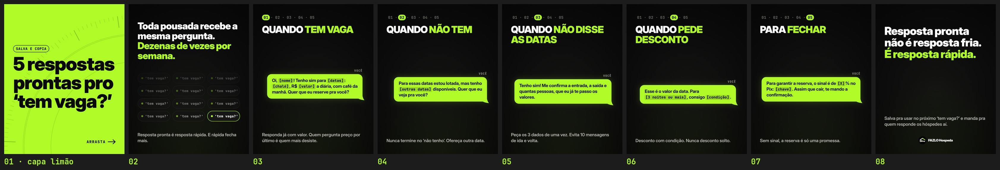

# FAZLO Hospeda — Carrossel 02 · Pilar DICA · "5 respostas prontas pro ‘tem vaga?’"

Carrossel estático para o Instagram, para ser salvo e copiado por donos de pousada. Segue o mesmo modelo, DNA e regras do [Carrossel 01](../carrossel-01) ("Como cobrar o sinal"). Não mostra telas do sistema e não tem CTA de venda. Não tem emojis nem mecânica de "comenta QUERO" ou de responder Story. Postagem prevista: domingo, às 12h.

**Formato:**
- 8 slides 1080×1350 (4:5), em PNG;
- margem de 80 px nas laterais (a grade do perfil mostra o centro 3:4 do post, cortando ~34 px de cada lado);
- **capa limão com texto preto**, a regra dos carrosséis do pilar DICA ([`../README.md`](../README.md)).

▶ **Para postar, nesta ordem:** [`output/01.png`](output/01.png) (capa) · [`02.png`](output/02.png) · [`03.png`](output/03.png) · [`04.png`](output/04.png) · [`05.png`](output/05.png) · [`06.png`](output/06.png) · [`07.png`](output/07.png) · [`08.png`](output/08.png)

**Prévia:** [`output/previa.jpg`](output/previa.jpg) · **Revisão:** [`output/revisao/`](output/revisao) · **Legenda:** [`legenda.txt`](legenda.txt) (sem emojis e sem CTA de venda)



## Os slides

| # | Título | Meio | Apoio |
|---|---|---|---|
| 01 | "5 respostas prontas" / "pro ‘tem vaga?’", capa limão com texto preto, em 3 linhas no maior corpo ("5 respostas / prontas pro / ‘tem vaga?’"; ‘tem vaga?’ nunca quebra) | chip "SALVA E COPIA" | "ARRASTA →" |
| 02 | "Toda pousada recebe a mesma pergunta." / "**Dezenas de vezes por semana.**" | uma parede de 12 cards "‘tem vaga?’" no desenho da série (#161616, borda, ponto limão), mais apagados no fundo; o último aceso, com borda limão | "Resposta pronta é resposta rápida. E rápida fecha mais." |
| 03 | trilha **01** · "QUANDO **TEM VAGA**" | bolha: "Oi, `[nome]`! Tenho sim para `[datas]`: `[chalé]`, R$ `[valor]` a diária, com café da manhã. Quer que eu reserve pra você?" | "Responda já com valor. Quem pergunta preço por último é quem mais desiste." |
| 04 | trilha **02** · "QUANDO **NÃO TEM**" | bolha: "Para essas datas estou lotada, mas tenho `[outras datas]` disponíveis. Quer que eu veja pra você?" | "Nunca termine no ‘não tenho’. Ofereça outra data." |
| 05 | trilha **03** · "QUANDO **NÃO DISSE AS DATAS**" | bolha: "Tenho sim! Me confirma a entrada, a saída e quantas pessoas, que eu já te passo os valores." | "Peça os 3 dados de uma vez. Evita 10 mensagens de ida e volta." |
| 06 | trilha **04** · "QUANDO **PEDE DESCONTO**" | bolha: "Esse é o valor da data. Para `[3 noites ou mais]`, consigo `[condição]`." | "Desconto com condição. Nunca desconto solto." |
| 07 | trilha **05** · "PARA **FECHAR**" | bolha: "Para garantir a reserva, o sinal é de `[X]`% no Pix: `[chave]`. Assim que cair, te mando a confirmação." | "Sem sinal, a reserva é só uma promessa." |
| 08 | "Resposta pronta não é resposta fria." / "**É resposta rápida.**" | — | "Salva pra usar no próximo ‘tem vaga?’ e manda pra quem responde os hóspedes aí." + logo pequena |

(Em negrito: o trecho em limão. Em `código`: os campos a preencher, que na bolha aparecem em JetBrains Mono, marcados num fundo levemente mais escuro.)

Os títulos dos slides 3 a 7 vêm do roteiro em caixa alta ("1 · QUANDO TEM VAGA"). O número vai para a trilha de passos, "QUANDO"/"PARA" fica em branco e a situação em limão. Os cinco usam o mesmo corpo (88 px), para a sequência ter o mesmo peso ao arrastar.

## Do modelo do Carrossel 01

- **O mesmo código:** fundo, trilha de passos, título que se ajusta à caixa, apoio, chip, "ARRASTA →", bolha do "VOCÊ" e logo vêm do `slides.js` do Carrossel 01.
- **Bolha:** agora aceita campos com espaço (`[outras datas]`, `[3 noites ou mais]`), que nunca quebram no meio.
- **Título:** aceita um limite de linhas (`lines`), usado na capa.
- **Capa:** usa o fundo limão do Carrossel 01, com a escala gravada ao fundo.
- **Fora daqui:** a notinha do Reel 07 não é usada.

## Revisão

`python3 scripts/previa.py` confere, pelos pixels, que nada além do fundo passa da margem de 80 px. Nos slides escuros conta o que tem luminância acima de 60; na capa limão, o que se destaca do limão (a escala gravada ao fundo não conta). Ele gera:
- [`margens.txt`](output/revisao/margens.txt): os 8 dentro, com conteúdo entre x 80 e 999;
- [`margens.jpg`](output/revisao/margens.jpg): a margem em azul e o corte da grade em vermelho;
- [`capa-na-grade.jpg`](output/revisao/capa-na-grade.jpg): a capa em miniatura, ao lado da capa do Carrossel 01 e da do ep-03 da série Rotina.

```bash
cd carrosseis/carrossel-02
node scripts/render.cjs          # os 8 slides (ou: node scripts/render.cjs 1,3)
python3 scripts/previa.py        # prévia e revisão
```
