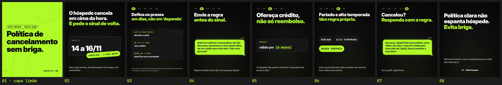

# FAZLO Hospeda — Carrossel 03 · Pilar DICA · "Política de cancelamento sem briga"

Carrossel estático para o Instagram, para ser salvo e compartilhado por donos de pousada. Segue o mesmo modelo, DNA e regras dos Carrosséis [01](../carrossel-01) e [02](../carrossel-02): não mostra telas do sistema, não tem CTA de venda e não tem emojis.

**Formato:**
- 8 slides 1080×1350 (4:5), em PNG;
- margem de 80 px nas laterais;
- **capa limão com texto preto** (a regra dos carrosséis do pilar DICA, em [`../README.md`](../README.md)).

▶ **Para postar, nesta ordem:** [`output/01.png`](output/01.png) (capa) · [`02.png`](output/02.png) · [`03.png`](output/03.png) · [`04.png`](output/04.png) · [`05.png`](output/05.png) · [`06.png`](output/06.png) · [`07.png`](output/07.png) · [`08.png`](output/08.png)

**Prévia:** [`output/previa.jpg`](output/previa.jpg) · **Revisão:** [`output/revisao/`](output/revisao) · **Legenda:** [`legenda.txt`](legenda.txt)



## Os slides

| # | Título | Meio | Apoio |
|---|---|---|---|
| 01 | "Política de cancelamento" / "sem briga." (capa limão, texto preto, em 3 linhas no maior corpo) | chip "GUIA RÁPIDO · SALVA ESSE" | "ARRASTA →" |
| 02 | "O hóspede cancela em cima da hora." / "**E pede o sinal de volta.**" | card da reserva (CHALÉ 2 · 14 a 16/11, o mesmo do Carrossel 01) com o selo limão "CANCELADA · 2 DIAS ANTES" carimbado | "Sem regra escrita, vira discussão. Com regra, vira combinado." |
| 03 | trilha **01** · "Defina os prazos" / "**em dias, não em ‘depende’.**" | 3 cards: "ATÉ 15 DIAS ANTES · devolve o sinal" · "DE 14 A 7 DIAS · vira crédito" · "MENOS DE 7 DIAS · sinal fica com a pousada" | nota: "Os prazos são exemplos. Monte a regra da sua pousada respeitando o Código de Defesa do Consumidor." |
| 04 | trilha **02** · "Envie a regra" / "**antes do sinal.**" | bolha: "Antes de confirmar, nossa política: até `[X]` dias antes, devolvemos o sinal; depois disso, ele vira crédito para outra data. Tudo certo pra você?" | "Regra enviada antes não vira surpresa depois." |
| 05 | trilha **03** · "Ofereça crédito," / "**não só reembolso.**" | card "CRÉDITO · válido por `[6 meses]`" | "O hóspede não perde o dinheiro. A pousada não perde a data." |
| 06 | trilha **04** · "Feriado e alta temporada" / "**têm regra própria.**" | chips "FERIADO" e "ALTA TEMPORADA" → "REGRA PRÓPRIA" (limão) | "Data concorrida não volta a vender em cima da hora. Deixe isso escrito." |
| 07 | trilha **05** · "Cancelou?" / "**Responda com a regra.**" | bolha: "Que pena, `[nome]`! Pela nossa política, como faltam `[X]` dias, o sinal vira crédito para outra data até `[data]`. Quer já escolher a nova data?" | "Tom gentil, regra firme." |
| 08 | "Política clara não espanta hóspede." / "**Evita briga.**" | — | "Salva pra montar a sua e manda pra quem cuida das reservas aí." + logo pequena |

(Em negrito: o trecho em limão. Em `código`: os campos a preencher, que na bolha e no card aparecem em JetBrains Mono, marcados. A pontuação vem colada no campo: "`[nome]`!", "`[data]`.".)

## Decisões de layout

- **Slide 6 sem visual no roteiro:** o roteiro trazia só título e apoio. Fiz um visual mínimo, só com as palavras do próprio título: dois chips "FERIADO" e "ALTA TEMPORADA" e o chip limão "REGRA PRÓPRIA". Não há prazo nem número novos. Dá para tirar sem mexer no resto.
- **Slide 2:** o card da reserva é o do Carrossel 01 (CHALÉ 2, 14 a 16/11), inteiro e nítido. O selo "CANCELADA · 2 DIAS ANTES" é um chip limão carimbado, levemente inclinado, como o carimbo dos Reels, dentro da margem.
- **Títulos dos slides 3, 6 e 7** ficam em duas linhas, no mesmo corpo (até 88 px), sem palavra sozinha.
- **Slide 3:** a nota sobre o Código de Defesa do Consumidor vai no lugar do apoio, em corpo menor (30 px) e cinza médio, como a nota do slide 5 do Carrossel 01.

## Revisão

`python3 scripts/previa.py` confere, pelos pixels, que nada além do fundo passa da margem de 80 px (nos slides escuros, o que tem luminância acima de 60; na capa limão, o que se destaca do limão): os 8 estão dentro, com conteúdo em x 79–1000 ([`margens.txt`](output/revisao/margens.txt), [`margens.jpg`](output/revisao/margens.jpg) com a margem em azul e o corte da grade em vermelho). A capa na grade do perfil está em [`capa-na-grade.jpg`](output/revisao/capa-na-grade.jpg).

```bash
cd carrosseis/carrossel-03
node scripts/render.cjs          # os 8 slides (ou: node scripts/render.cjs 3,7)
python3 scripts/previa.py        # prévia e revisão
```
