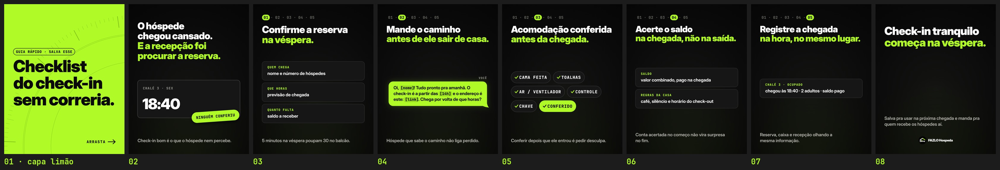

# FAZLO Hospeda — Carrossel 04 · Pilar DICA · "Checklist do check-in"

Carrossel estático para o Instagram, para ser salvo e compartilhado por donos de pousada. Feito a partir do [Carrossel 03](../carrossel-03): o mesmo modelo, as mesmas cores e fontes, margem de 80 px, trilha de passos 01–05, capa limão com texto preto e bolha limão do "VOCÊ" com os `[campos]` em mono e a pontuação colada. Sem emojis e sem telas do sistema. Só o conteúdo mudou.

**Formato:** 8 slides 1080×1350 (4:5), em PNG.

▶ **Para postar, nesta ordem:** [`output/01.png`](output/01.png) (capa limão) · [`02.png`](output/02.png) · [`03.png`](output/03.png) · [`04.png`](output/04.png) · [`05.png`](output/05.png) · [`06.png`](output/06.png) · [`07.png`](output/07.png) · [`08.png`](output/08.png)

**Prévia:** [`output/previa.jpg`](output/previa.jpg) · **Revisão:** [`output/revisao/`](output/revisao) · **Legenda:** [`legenda.txt`](legenda.txt)



## Os slides

| # | Título | Meio | Apoio |
|---|---|---|---|
| 01 | "Checklist" / "do check-in" / "sem correria." (capa limão, texto preto) | chip "GUIA RÁPIDO · SALVA ESSE" | "ARRASTA →" |
| 02 | "O hóspede chegou cansado." / "**E a recepção foi procurar a reserva.**" | card de chegada "CHALÉ 3 · SEX" · **18:40**, com o selo limão carimbado "NINGUÉM CONFERIU" | "Check-in bom é o que o hóspede nem percebe." |
| 03 | trilha **01** · "Confirme a reserva" / "**na véspera.**" | 3 cards: "QUEM CHEGA · nome e número de hóspedes" · "QUE HORAS · previsão de chegada" · "QUANTO FALTA · saldo a receber" | "5 minutos na véspera poupam 30 no balcão." |
| 04 | trilha **02** · "Mande o caminho" / "**antes de ele sair de casa.**" | bolha: "Oi, `[nome]`! Tudo pronto pra amanhã. O check-in é a partir das `[14h]` e o endereço é este: `[link]`. Chega por volta de que horas?" | "Hóspede que sabe o caminho não liga perdido." |
| 05 | trilha **03** · "Acomodação conferida" / "**antes da chegada.**" | chips com o ícone de check: CAMA FEITA · TOALHAS · AR / VENTILADOR · CONTROLE · CHAVE e, em destaque limão, **CONFERIDO** | "Conferir depois que ele entrou é pedir desculpa." |
| 06 | trilha **04** · "Acerte o saldo" / "**na chegada, não na saída.**" | 2 cards: "SALDO · valor combinado, pago na chegada" · "REGRAS DA CASA · café, silêncio e horário do check-out" | "Conta acertada no começo não vira surpresa no fim." |
| 07 | trilha **05** · "Registre a chegada" / "**na hora, no mesmo lugar.**" | card "CHALÉ 3 · OCUPADO · chegou às 18:40 · 2 adultos · saldo pago" | "Reserva, caixa e recepção olhando a mesma informação." |
| 08 | "Check-in tranquilo" / "**começa na véspera.**" | — | "Salva pra usar na próxima chegada e manda pra quem recebe os hóspedes aí." + logo pequena |

(Em negrito: o trecho em limão.)

## Revisão

`node scripts/render.cjs` e `python3 scripts/previa.py` geram a prévia e três conferências:
- **Margens** ([`margens.txt`](output/revisao/margens.txt), [`margens.jpg`](output/revisao/margens.jpg) com a margem em azul e o corte da grade em vermelho): os 8 slides ficam dentro dos 80 px.
- **Capa no recorte 3:4** ([`capa-na-grade.jpg`](output/revisao/capa-na-grade.jpg)): os três títulos da capa ficam inteiros e dentro da grade.
- **Palavra sozinha numa linha** ([`linhas.txt`](output/revisao/linhas.txt)): o motor registra as linhas de texto de cada slide e confere que nenhuma tem uma palavra só vinda da quebra automática. Quando acontecia, o título diminui ou o apoio estreita até equilibrar; no slide 2, a quebra é a do roteiro, em 4 linhas. As quebras de uma palavra que o roteiro pede, como "Checklist" na capa, não contam.

```bash
cd carrosseis/carrossel-04
node scripts/render.cjs          # os 8 slides + linhas.txt
python3 scripts/previa.py        # prévia e margens
```
