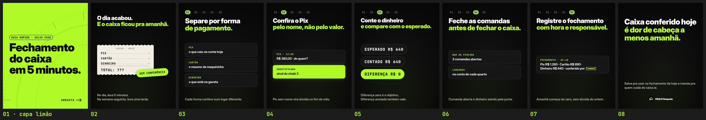

# FAZLO Hospeda — Carrossel 05 · Pilar DICA · "Fechamento do caixa do dia"

Carrossel estático para o Instagram (para sexta, 12h), para ser salvo e compartilhado por donos de pousada. Feito a partir do [Carrossel 04](../carrossel-04): o mesmo modelo, as mesmas cores e fontes, margem de 80 px, trilha de passos 01–05, capa limão com texto preto e cards rotulados em mono. Sem emojis e sem telas do sistema. Só o conteúdo mudou.

**Formato:** 8 slides 1080×1350 (4:5), em PNG.

▶ **Para postar, nesta ordem:** [`output/01.png`](output/01.png) (capa limão) · [`02.png`](output/02.png) · [`03.png`](output/03.png) · [`04.png`](output/04.png) · [`05.png`](output/05.png) · [`06.png`](output/06.png) · [`07.png`](output/07.png) · [`08.png`](output/08.png)

**Prévia:** [`output/previa.jpg`](output/previa.jpg) · **Revisão:** [`output/revisao/`](output/revisao) · **Legenda:** [`legenda.txt`](legenda.txt)



## Os slides

| # | Título | Meio | Apoio |
|---|---|---|---|
| 01 | "Fechamento" / "do caixa" / "em 5 minutos." (capa limão, texto preto) | chip "GUIA RÁPIDO · SALVA ESSE" | "ARRASTA →" |
| 02 | "O dia acabou." / "**E o caixa ficou pra amanhã.**" | notinha de caixa (papel claro, borda serrilhada): PIX · CARTÃO · DINHEIRO · "TOTAL: ???", com o selo limão carimbado "SEM CONFERÊNCIA" | "No dia, leva 5 minutos. Na semana seguinte, leva uma tarde." |
| 03 | trilha **01** · "Separe por forma" / "**de pagamento.**" | 3 cards: "PIX · o que caiu na conta hoje" · "CARTÃO · o resumo da maquininha" · "DINHEIRO · o que está na gaveta" | "Cada forma confere num lugar diferente." |
| 04 | trilha **02** · "Confira o Pix" / "**pelo nome, não pelo valor.**" | card "PIX · 14:02 · R$ 380,00 · de quem?" e, embaixo, card limão "IDENTIFICADO · sinal do chalé 3" | "Pix sem nome vira dúvida no fim do mês." |
| 05 | trilha **03** · "Conte o dinheiro" / "**e compare com o esperado.**" | 3 chips grandes: ESPERADO R$ 640 · CONTADO R$ 640 · **DIFERENÇA R$ 0** (limão) | "Diferença zero é o objetivo. Diferença anotada também vale." |
| 06 | trilha **04** · "Feche as comandas" / "**antes de fechar o caixa.**" | 2 cards: "BAR DA PISCINA · 3 comandas abertas" · "LANÇADAS · na conta de cada quarto" | "Comanda aberta é dinheiro saindo pela porta." |
| 07 | trilha **05** · "Registre o fechamento" / "**com hora e responsável.**" | card "FECHAMENTO · 21:40 · Pix R$ 1.260 · Cartão R$ 890 · Dinheiro R$ 640 · conferido por `[nome]`" | "Amanhã começa do zero, sem dúvida de ontem." |
| 08 | "Caixa conferido hoje" / "**é dor de cabeça a menos amanhã.**" | — | "Salva pra usar no fechamento de hoje e manda pra quem cuida do caixa aí." + logo pequena |

(Em negrito: o trecho em limão.)

## Revisão

`node scripts/render.cjs` e `python3 scripts/previa.py` geram a prévia e três conferências:
- **Margens** ([`margens.txt`](output/revisao/margens.txt), [`margens.jpg`](output/revisao/margens.jpg) com a margem em azul e o corte da grade em vermelho): os 8 slides ficam dentro dos 80 px.
- **Capa no recorte 3:4** ([`capa-na-grade.jpg`](output/revisao/capa-na-grade.jpg)): os três títulos da capa ficam inteiros e dentro da grade.
- **Palavra sozinha numa linha** ([`linhas.txt`](output/revisao/linhas.txt)): o motor registra as linhas de texto de cada slide e confere que nenhuma tem uma palavra só vinda da quebra automática. Quando acontece, o título diminui, o apoio estreita ou o card leva a palavra anterior junto; um valor com a moeda ("Dinheiro R$ 640") nunca quebra no meio. As quebras de uma palavra que o roteiro pede, como "Fechamento" na capa, não contam.

```bash
cd carrosseis/carrossel-05
node scripts/render.cjs          # os 8 slides + linhas.txt
python3 scripts/previa.py        # prévia e margens
```
