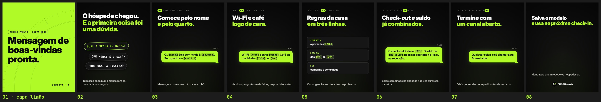

# FAZLO Hospeda — Carrossel 06 · Pilar DICA · "Mensagem de boas-vindas pronta"

Carrossel estático para o Instagram (para sábado, 19h), para ser salvo e compartilhado por donos de pousada. Feito a partir do [Carrossel 05](../carrossel-05): o mesmo modelo, as mesmas cores e fontes, margem de 80 px, trilha de passos 01–05, capa limão com texto preto, bolhas limão do "VOCÊ" com os `[campos]` em mono e a pontuação colada neles, e cards rotulados em mono. Sem emojis e sem telas do sistema; nome de pousada nunca em caixa alta (aqui é o campo `[pousada]`). Só o conteúdo mudou.

**Formato:** 8 slides 1080×1350 (4:5), em PNG.

▶ **Para postar, nesta ordem:** [`output/01.png`](output/01.png) (capa limão) · [`02.png`](output/02.png) · [`03.png`](output/03.png) · [`04.png`](output/04.png) · [`05.png`](output/05.png) · [`06.png`](output/06.png) · [`07.png`](output/07.png) · [`08.png`](output/08.png)

**Prévia:** [`output/previa.jpg`](output/previa.jpg) · **Revisão:** [`output/revisao/`](output/revisao) · **Legenda:** [`legenda.txt`](legenda.txt)



## Os slides

| # | Título | Meio | Apoio |
|---|---|---|---|
| 01 | "Mensagem de" / "boas-vindas" / "pronta." (capa limão, texto preto) | chip "MODELO PRONTO · SALVA ESSE" | "ARRASTA →" |
| 02 | "O hóspede chegou." / "**E a primeira coisa foi uma dúvida.**" | 3 chips de pergunta empilhados, levemente desalinhados: QUAL A SENHA DO WI-FI? · QUE HORAS É O CAFÉ? · PODE USAR A PISCINA? | "Tudo isso cabe numa mensagem só, mandada na chegada." |
| 03 | trilha **01** · "Comece pelo nome" / "**e pelo quarto.**" | bolha: "Oi, `[nome]`! Seja bem-vindo à `[pousada]`. Seu quarto é o `[chalé 3]`." | "Mensagem com nome não parece robô." |
| 04 | trilha **02** · "Wi-Fi e café" / "**logo de cara.**" | bolha: "Wi-Fi: `[rede]`, senha `[senha]`. Café da manhã das `[7h30]` às `[10h]`." | "As duas perguntas mais feitas, respondidas antes." |
| 05 | trilha **03** · "Regras da casa" / "**em três linhas.**" | 3 cards: "SILÊNCIO · a partir das `[22h]`" · "PISCINA · das `[8h]` às `[20h]`" · "PET · conforme o combinado" | "Curto, gentil e escrito antes do problema." |
| 06 | trilha **04** · "Check-out e saldo" / "**já combinados.**" | bolha: "O check-out é até as `[12h]`. O saldo de `[R$ valor]` pode ser acertado no Pix ou na recepção." | "Saldo combinado na chegada não vira surpresa na saída." |
| 07 | trilha **05** · "Termine com" / "**um canal aberto.**" | bolha: "Qualquer coisa, é só chamar aqui. Boa estadia!" | "O hóspede sabe onde pedir antes de reclamar." |
| 08 | "Salva o modelo" / "**e usa no próximo check-in.**" | — | "Manda pra quem recebe os hóspedes aí." + logo pequena |

(Em negrito: o trecho em limão.)

## Revisão

`node scripts/render.cjs` e `python3 scripts/previa.py` geram a prévia e três conferências:
- **Margens** ([`margens.txt`](output/revisao/margens.txt), [`margens.jpg`](output/revisao/margens.jpg) com a margem em azul e o corte da grade em vermelho): os 8 slides ficam dentro dos 80 px.
- **Capa no recorte 3:4** ([`capa-na-grade.jpg`](output/revisao/capa-na-grade.jpg)): os três títulos da capa ficam inteiros e dentro da grade.
- **Palavra sozinha numa linha** ([`linhas.txt`](output/revisao/linhas.txt)): o motor registra as linhas de texto de cada slide e confere que nenhuma tem uma palavra só vinda da quebra automática. Quando acontece, o título diminui, o apoio estreita ou o card ou a bolha leva a palavra anterior junto; um valor com a moeda ("Dinheiro R$ 640") nunca quebra no meio. As quebras de uma palavra que o roteiro pede, como "pronta." na capa, não contam.

```bash
cd carrosseis/carrossel-06
node scripts/render.cjs          # os 8 slides + linhas.txt
python3 scripts/previa.py        # prévia e margens
```

Nas margens, o texto alinhado à esquerda começa pela tinta da 1ª letra: o gancho do "j" (em "já combinados.") não passa dos 80 px.
