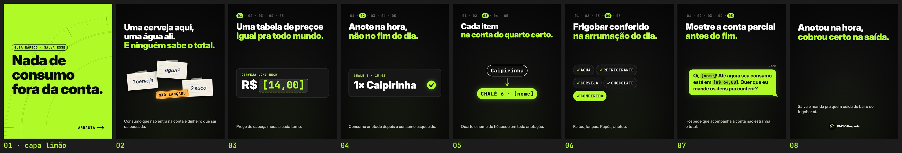

# FAZLO Hospeda · Carrossel "Nada de consumo fora da conta" · Pilar DICA

Tema: bar, frigobar e consumo do hóspede lançados na conta certa, na hora.

É conteúdo educativo, feito a partir do carrossel aprovado [Checklist do check-out](../checkout) (3a93548), que segue o [overbooking](../overbooking) e o [reveillon](../reveillon). Usa o mesmo motor, cores, fontes, margem de 80 px, trilha de passos 01–05, bolha limão do "VOCÊ" e chips com check. Segue também o padrão fechado neles:
- capa limão com texto preto, no maior corpo que cabe;
- nos slides com card, o dado é o destaque: valor em corpo grande e rótulo em mono acima, centrado entre o título e o apoio.

Além disso:
- Não mostra telas do sistema.
- Os dados variáveis aparecem como `[campos]` em mono.
- Não tem CTA de venda nem emojis nos slides.

**Formato:** 8 slides 1080×1350 (4:5), em PNG.

▶ **Para postar, nesta ordem:** [`output/01.png`](output/01.png) (capa limão) · [`02.png`](output/02.png) · [`03.png`](output/03.png) · [`04.png`](output/04.png) · [`05.png`](output/05.png) · [`06.png`](output/06.png) · [`07.png`](output/07.png) · [`08.png`](output/08.png)

**Prévia:** [`output/previa.jpg`](output/previa.jpg) · **Revisão:** [`output/revisao/`](output/revisao) · **Legenda do post:** [`legenda.txt`](legenda.txt)



## Os slides

| # | Título (em negrito, o trecho limão) | Meio |
|---|---|---|
| 01 | "Nada de / consumo / fora da conta." (capa limão, texto preto, quebra do roteiro) | chip "GUIA RÁPIDO · SALVA ESSE" · "ARRASTA →" |
| 02 | "Uma cerveja aqui, / uma água ali. / **E ninguém sabe o total.**" | três anotações soltas e tortas em papel claro, com fita e letra de mão discreta: "1 cerveja", "água?", "2 suco". Sobre elas, o carimbo âmbar "NÃO LANÇADO", inclinado · apoio: "Consumo que não entra na conta é dinheiro que sai da pousada." |
| 03 | trilha **01** · "Uma tabela de preços / **igual pra todo mundo.**" | card em destaque: CERVEJA LONG NECK · **R$ `[14,00]`** (120 px) · apoio: "Preço de cabeça muda a cada turno." |
| 04 | trilha **02** · "Anote na hora, / **não no fim do dia.**" | card em destaque: CHALÉ 6 · 15:42 · **1× Caipirinha** (104 px), com o check limão ao lado · apoio: "Consumo anotado depois é consumo esquecido." |
| 05 | trilha **03** · "Cada item / **na conta do quarto certo.**" | chip grande "Caipirinha" ↓ chip limão grande "CHALÉ 6 · `[nome]`" · apoio: "Quarto e nome do hóspede em toda anotação." |
| 06 | trilha **04** · "Frigobar conferido / **na arrumação do dia.**" | chips grandes com check: ÁGUA · REFRIGERANTE · CERVEJA · CHOCOLATE e, em destaque limão, CONFERIDO · apoio: "Faltou, lançou. Repôs, anotou." |
| 07 | trilha **05** · "Mostre a conta parcial / **antes do fim.**" | bolha VOCÊ grande, centrada: "Oi, `[nome]`! Até agora seu consumo está em `[R$ 64,00]`. Quer que eu mande os itens pra conferir?" · apoio: "Hóspede que acompanha a conta não estranha o total." |
| 08 | "Anotou na hora, / **cobrou certo na saída.**" | apoio: "Salva e manda pra quem cuida do bar e do frigobar aí." · logo |

**Títulos:**
- **Capa:** segue a quebra do roteiro, no maior corpo que cabe dentro da margem. O limite é a largura de "fora da conta.".
- **Slide 02:** a quebra também está fixada no código, porque a quebra automática deixava "uma" no fim de uma linha.

**Letra de mão (02):** não há fonte manuscrita no projeto. As anotações usam a Inter Display inclinada, em tinta azul-escura, o mesmo recurso do "Motivo" escrito à mão no Reel "Vai fechar o caixa?".

**Tamanho do valor em destaque:** fica entre 104 e 120 px, 2,6× a 3× os 40 px do texto do card comum. No 04, 104 px é o maior corpo em que "1× Caipirinha" cabe na mesma linha do check.

## Revisão

```bash
cd carrosseis/consumo
node scripts/render.cjs      # os 8 slides + output/revisao/linhas.txt (nenhuma palavra sozinha numa linha)
python3 scripts/previa.py    # prévia, margens (80 px) e a capa na grade do perfil (recorte 3:4)
```

**Resultado:**
- **Margens:** os 8 slides ficam dentro dos 80 px ([`margens.txt`](output/revisao/margens.txt)).
- **Linhas:** nenhuma palavra sozinha numa linha ([`linhas.txt`](output/revisao/linhas.txt)).
- **Capa na grade:** o título fica inteiro no recorte 3:4 ([`capa-na-grade.jpg`](output/revisao/capa-na-grade.jpg)).
