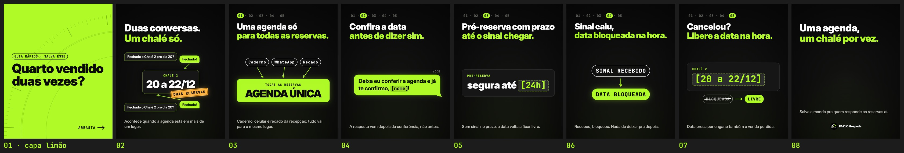

# FAZLO Hospeda · Carrossel "Quarto vendido duas vezes?" · Pilar DICA

Tema: overbooking na pousada, com cinco regras para não vender o mesmo chalé duas vezes.

É conteúdo educativo, feito a partir do carrossel aprovado [Réveillon na pousada](../reveillon) (c439e44). Usa o mesmo motor, cores, fontes, margem de 80 px, trilha de passos 01–05 e bolha limão do "VOCÊ". Segue também o padrão fechado nele:
- capa limão com texto preto, no maior corpo que cabe;
- nos slides com card, o dado é o destaque: valor em corpo grande e rótulo em mono acima, centrado entre o título e o apoio.

Além disso:
- Não mostra telas do sistema.
- Os dados variáveis aparecem como `[campos]` em mono.
- Não tem CTA de venda nem emojis nos slides.

**Formato:** 8 slides 1080×1350 (4:5), em PNG.

▶ **Para postar, nesta ordem:** [`output/01.png`](output/01.png) (capa limão) · [`02.png`](output/02.png) · [`03.png`](output/03.png) · [`04.png`](output/04.png) · [`05.png`](output/05.png) · [`06.png`](output/06.png) · [`07.png`](output/07.png) · [`08.png`](output/08.png)

**Prévia:** [`output/previa.jpg`](output/previa.jpg) · **Revisão:** [`output/revisao/`](output/revisao) · **Legenda do post:** [`legenda.txt`](legenda.txt)



## Os slides

| # | Título (em negrito, o trecho limão) | Meio |
|---|---|---|
| 01 | "Quarto vendido / duas vezes?" (capa limão, texto preto) | chip "GUIA RÁPIDO · SALVA ESSE" · "ARRASTA →" |
| 02 | "Duas conversas. / **Um chalé só.**" | duas conversas, uma acima e outra abaixo do card. Em cada uma, o hóspede pergunta "Fechado o Chalé 2 pro dia 20?" e a resposta limão é "Fechado!". As setas apontam para o card "CHALÉ 2 · 20 a 22/12", com o carimbo âmbar "DUAS RESERVAS" inclinado · apoio: "Acontece quando a agenda está em mais de um lugar." |
| 03 | trilha **01** · "Uma agenda só / **para todas as reservas.**" | chips "Caderno", "WhatsApp" e "Recado" com setas convergindo para o card limão grande "TODAS AS RESERVAS · AGENDA ÚNICA" (104 px) · apoio: "Caderno, celular e recado da recepção: tudo vai para o mesmo lugar." |
| 04 | trilha **02** · "Confira a data / **antes de dizer sim.**" | bolha VOCÊ grande (56 px), centrada: "Deixa eu conferir a agenda e já te confirmo, `[nome]`!" · apoio: "A resposta vem depois da conferência, não antes." |
| 05 | trilha **03** · "Pré-reserva com prazo / **até o sinal chegar.**" | card em destaque: PRÉ-RESERVA · **segura até `[24h]`** (100 px) · apoio: "Sem sinal no prazo, a data volta a ficar livre." |
| 06 | trilha **04** · "Sinal caiu, / **data bloqueada na hora.**" | chip grande "SINAL RECEBIDO" ↓ chip limão grande "DATA BLOQUEADA" (54 px) · apoio: "Recebeu, bloqueou. Nada de deixar pra depois." |
| 07 | trilha **05** · "Cancelou? / **Libere a data na hora.**" | card em destaque: CHALÉ 2 · **`[20 a 22/12]`** (110 px), e abaixo o selo "BLOQUEADA" riscado → selo limão "LIVRE" · apoio: "Data presa por engano também é venda perdida." |
| 08 | "Uma agenda, / **um chalé por vez.**" | apoio: "Salva e manda pra quem responde as reservas aí." · logo |

**Capa:** o título fica em 2 linhas, no maior corpo que cabe dentro da margem. "Quarto vendido" ocupa a largura toda, então a letra sai um pouco menor que a da capa do Carrossel 01. Quebrar em 3 linhas deixaria uma palavra sozinha.

**Tamanho do valor em destaque (05 e 07):** fica entre 100 e 110 px, 2,5× a 2,75× os 40 px do texto do card comum. No 05, 100 px é o maior corpo em que "segura até `[24h]`" cabe numa linha só, sem deixar o `[24h]` sozinho.

## Revisão

```bash
cd carrosseis/overbooking
node scripts/render.cjs      # os 8 slides + output/revisao/linhas.txt (nenhuma palavra sozinha numa linha)
python3 scripts/previa.py    # prévia, margens (80 px) e a capa na grade do perfil (recorte 3:4)
```

**Resultado:**
- **Margens:** os 8 slides ficam dentro dos 80 px ([`margens.txt`](output/revisao/margens.txt)).
- **Linhas:** nenhuma palavra sozinha numa linha ([`linhas.txt`](output/revisao/linhas.txt)).
- **Capa na grade:** o título fica inteiro no recorte 3:4 ([`capa-na-grade.jpg`](output/revisao/capa-na-grade.jpg)).
