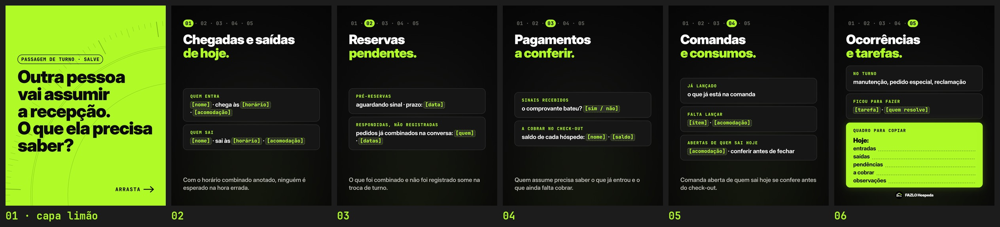

# FAZLO Hospeda · Carrossel "Passagem da recepção" · Pilar DICA

Para quarta, 28/10/2026. Tema: "Outra pessoa vai assumir a recepção. O que ela precisa saber?"

É conteúdo educativo, feito a partir do [Carrossel 06](../carrossel-06), com o mesmo motor, cores, fontes, margem de 80 px, capa limão com texto preto, trilha de passos e cards rotulados.
- Não mostra telas do sistema.
- Não usa nomes nem valores: os dados aparecem como `[campos]` para preencher.
- Não tem CTA de venda nem emojis nos slides.

**Formato:** 6 slides 1080×1350 (4:5), em PNG.

▶ **Para postar, nesta ordem:** [`output/01.png`](output/01.png) (capa limão) · [`02.png`](output/02.png) · [`03.png`](output/03.png) · [`04.png`](output/04.png) · [`05.png`](output/05.png) · [`06.png`](output/06.png)

**Prévia:** [`output/previa.jpg`](output/previa.jpg) · **Revisão:** [`output/revisao/`](output/revisao) · **Legenda do post:** [`legenda.txt`](legenda.txt)



## Os slides

| # | Título (em negrito, o trecho limão) | Meio |
|---|---|---|
| 01 | "Outra pessoa / vai assumir / a recepção. / O que ela precisa / saber?" (capa limão, texto preto) | chip "PASSAGEM DE TURNO · SALVE" · "ARRASTA →" |
| 02 | trilha **01** · "Chegadas e saídas / **de hoje.**" | QUEM ENTRA: `[nome]` · chega às `[horário]` · `[acomodação]` · QUEM SAI: `[nome]` · sai às `[horário]` · `[acomodação]` |
| 03 | trilha **02** · "Reservas / **pendentes.**" | PRÉ-RESERVAS: aguardando sinal · prazo: `[data]` · RESPONDIDAS, NÃO REGISTRADAS: pedidos já combinados na conversa: `[quem]` · `[datas]` |
| 04 | trilha **03** · "Pagamentos / **a conferir.**" | SINAIS RECEBIDOS: o comprovante bateu? `[sim / não]` · A COBRAR NO CHECK-OUT: saldo de cada hóspede: `[nome]` · `[saldo]` |
| 05 | trilha **04** · "Comandas / **e consumos.**" | JÁ LANÇADO · FALTA LANÇAR: `[item]` · `[acomodação]` · ABERTAS DE QUEM SAI HOJE: `[acomodação]` · conferir antes de fechar |
| 06 | trilha **05** · "Ocorrências / **e tarefas.**" | NO TURNO: manutenção, pedido especial, reclamação · FICOU PARA FAZER: `[tarefa]` · `[quem resolve]` · card limão "QUADRO PARA COPIAR": Hoje: entradas __ · saídas __ · pendências __ · a cobrar __ · observações __ · logo |

## Revisão

```bash
cd carrosseis/passagem-recepcao
node scripts/render.cjs      # os 6 slides + output/revisao/linhas.txt (nenhuma palavra sozinha numa linha)
python3 scripts/previa.py    # prévia, margens (80 px) e a capa na grade do perfil (recorte 3:4)
```

**Resultado:**
- **Margens:** os 6 slides ficam dentro dos 80 px ([`margens.txt`](output/revisao/margens.txt)).
- **Linhas:** nenhuma palavra sozinha numa linha ([`linhas.txt`](output/revisao/linhas.txt)).
- **Capa na grade:** o título fica inteiro no recorte 3:4 ([`capa-na-grade.jpg`](output/revisao/capa-na-grade.jpg)).
