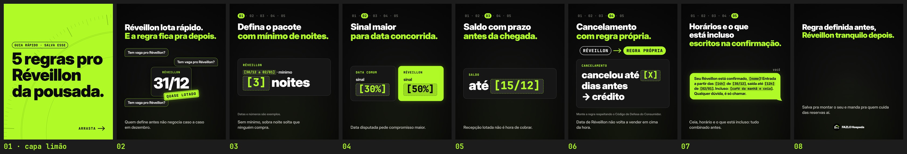

# FAZLO Hospeda · Carrossel "Réveillon na pousada" · Pilar DICA

Tema: "Réveillon na pousada: 5 regras antes de abrir as reservas."

É conteúdo educativo, feito a partir do carrossel [Passagem da recepção](../passagem-recepcao), que segue o [Carrossel 06](../carrossel-06). Usa o mesmo motor, cores, fontes, margem de 80 px, capa limão com texto preto, trilha de passos 01–05, cards rotulados em mono e bolha limão do "VOCÊ".
- Não mostra telas do sistema.
- Datas e números são exemplos: aparecem como `[campos]` para preencher.
- Não tem CTA de venda nem emojis nos slides.

**Formato:** 8 slides 1080×1350 (4:5), em PNG.

▶ **Para postar, nesta ordem:** [`output/01.png`](output/01.png) (capa limão) · [`02.png`](output/02.png) · [`03.png`](output/03.png) · [`04.png`](output/04.png) · [`05.png`](output/05.png) · [`06.png`](output/06.png) · [`07.png`](output/07.png) · [`08.png`](output/08.png)

**Prévia:** [`output/previa.jpg`](output/previa.jpg) · **Revisão:** [`output/revisao/`](output/revisao) · **Legenda do post:** [`legenda.txt`](legenda.txt)



## Os slides

| # | Título (em negrito, o trecho limão) | Meio |
|---|---|---|
| 01 | "5 regras pro / Réveillon / da pousada." (capa limão, texto preto, no corpo da capa do Carrossel 01) | chip "GUIA RÁPIDO · SALVA ESSE" · "ARRASTA →" |
| 02 | "Réveillon lota rápido. / **E a regra fica pra depois.**" | três balões "Tem vaga pro Réveillon?" chegando em volta do card "RÉVEILLON · 31/12", com o carimbo limão "QUASE LOTADO" inclinado · apoio: "Quem define antes não negocia caso a caso em dezembro." |
| 03 | trilha **01** · "Defina o pacote / **com mínimo de noites.**" | card em destaque: RÉVEILLON · `[30/12 a 02/01]` · mínimo / **`[3]` noites** (130 px) · nota: "Datas e números são exemplos." · apoio: "Sem mínimo, sobra noite solta que ninguém compra." |
| 04 | trilha **02** · "Sinal maior / **para data concorrida.**" | dois cards em destaque lado a lado: DATA COMUM · sinal **`[30%]`** e RÉVEILLON · sinal **`[50%]`** (limão), valores em 110 px · apoio: "Data disputada pede compromisso maior." |
| 05 | trilha **03** · "Saldo com prazo / **antes da chegada.**" | card em destaque: SALDO · **até `[15/12]`** (130 px) · apoio: "Recepção lotada não é hora de cobrar." |
| 06 | trilha **04** · "Cancelamento / **com regra própria.**" | chips maiores "RÉVEILLON" → limão "REGRA PRÓPRIA" · card em destaque: CANCELAMENTO · **cancelou até `[X]` dias antes → crédito** (96 px) · nota: "Monte a regra respeitando o Código de Defesa do Consumidor." · apoio: "Data de Réveillon não volta a vender em cima da hora." |
| 07 | trilha **05** · "Horários e o que / está incluso / **escritos na confirmação.**" | bolha VOCÊ: "Seu Réveillon está confirmado, `[nome]`! Entrada a partir das `[14h]` de `[30/12]`, saída até `[12h]` de `[02/01]`. Incluso: `[café da manhã e ceia]`. Qualquer dúvida, é só chamar." · apoio: "Ceia, horário e o que está incluso: tudo combinado antes." |
| 08 | "Regra definida antes, / **Réveillon tranquilo depois.**" | apoio: "Salva pra montar o seu e manda pra quem cuida das reservas aí." · logo |

**Títulos:** todos ficam em 2 ou 3 linhas. O do 07 tem a quebra fixada no código para não sobrar palavra sozinha numa linha e fica em 3 linhas para manter o corpo dos outros passos. A capa tem um título mais curto que a legenda do post. A legenda.txt continua com "Réveillon na pousada: 5 regras antes de abrir as reservas."

**O dado como destaque (03–06):** cada card tem o rótulo em mono e o valor principal em corpo grande, de 96 a 130 px (2,4× a 3,3× os 40 px do texto do card comum).
- Os `[campos]` aparecem em mono, numa caixa tracejada.
- O card fica centrado entre o título e o que vem embaixo: a nota, nos slides 03 e 06, ou o apoio.

## Revisão

```bash
cd carrosseis/reveillon
node scripts/render.cjs      # os 8 slides + output/revisao/linhas.txt (nenhuma palavra sozinha numa linha)
python3 scripts/previa.py    # prévia, margens (80 px) e a capa na grade do perfil (recorte 3:4)
```

**Resultado:**
- **Margens:** os 8 slides ficam dentro dos 80 px ([`margens.txt`](output/revisao/margens.txt)).
- **Linhas:** nenhuma palavra sozinha numa linha ([`linhas.txt`](output/revisao/linhas.txt)).
- **Capa na grade:** o título fica inteiro no recorte 3:4 ([`capa-na-grade.jpg`](output/revisao/capa-na-grade.jpg)).
