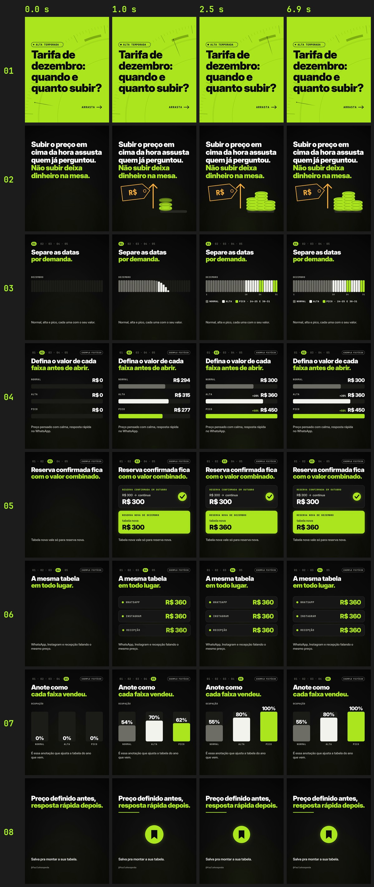

# FAZLO Hospeda · Carrossel ANIMADO "Tarifa de dezembro: quando e quanto subir?" · Pilar DICA

**Piloto de carrossel animado:** um teste contra os carrosséis estáticos. Nada foi publicado.

Tema: tarifa de alta temporada definida antes de abrir as reservas. O conteúdo é educativo e os valores são um exemplo
fictício (selo "EXEMPLO FICTÍCIO" nos slides com valores). Não tem telas do app, CTA de venda nem logo grande.

Usa a identidade e o motor dos carrosséis estáticos: o mesmo [`consumo/`](../consumo), com cores, fontes, margem de
80 px, capa limão com texto preto (a regra fixa das capas, [`../README.md`](../README.md)), trilha de passos 01–05 e
cards com rótulo em mono.

**Formato (v2):** 8 slides, cada um um vídeo MP4 de 1080×1350 (4:5), 9 s (o 02, 10 s) a 30 fps, H.264 yuv420p, com
uma faixa de áudio AAC silenciosa. Não tem trilha, narração nem legenda na tela. **Legenda do post:**
[`legenda.txt`](legenda.txt).



## v2 — refação em cenas (2026-11-20) · ETAPAS 1 e 2: os 8 slides

**A direção:** cada slide é uma pequena CENA animada que conta a ideia sozinha, com camadas, profundidade e
coreografia. O texto do slide fica FIXO desde o quadro 0 e nunca se mexe; a cena acontece entre o título e o apoio.

- **Formato:** 9 s por slide (10 s no 02), 1080×1350, 30 fps, H.264 yuv420p (CRF 12, `-tune animation`) e faixa AAC
  silenciosa.
- **Ritmo:** a cena tem começo, meio e fim até ~6,5 s (~7,5 s no 02). Depois o estado final fica vivo (brilho,
  partículas leves, pulsos). Nos últimos 0,75 s, a cena se dissolve suavemente de volta ao quadro 0 (só o texto), e o
  último quadro emenda no primeiro. Na capa não há dissolução: o letreiro volta sozinho a R$ 300.
- **Altura:** o texto de apoio fica logo acima da faixa do ícone de som (base em y ~1180) e as cenas ocupam o espaço
  entre o título e o apoio.
- **Âmbar #E8A317:** só para alerta (no 02).
- **Para postar, nesta ordem:** [`output/01.mp4`](output/01.mp4) … [`08.mp4`](output/08.mp4).
- **Versão estática de segurança:** [`output/png/`](output/png), com o estado final de cada cena, antes de ela se
  dissolver.
- **Revisão:**
  - prévia: [`output/previa.jpg`](output/previa.jpg) (0 s, 2 s, 4,5 s e o estado final);
  - storyboard: [`output/revisao/storyboard.jpg`](output/revisao/storyboard.jpg) (início, meio, clímax e final);
  - conferência: [`output/revisao/conferencia.txt`](output/revisao/conferencia.txt) (os 8 slides; e
    `conferencia-NN.txt` por slide).

| # | A cena |
|---|---|
| 01 | Capa limão. O título fica parado desde o quadro 0. Embaixo, um letreiro de aeroporto (split-flap, com o flap visível) vira R$ 300 → 360 → 450 e volta a 300 no loop. O rótulo do letreiro troca junto: DIÁRIA · NORMAL / ALTA +20% / PICO +50%. |
| 02 | TELA DIVIDIDA. **Em cima, "SUBIU EM CIMA DA HORA" (âmbar):** a conversa (pergunta, R$ 300, "3 dias depois", "Agora está R$ 450", o susto em âmbar e o "visualizado"). No fim ela esmaece até 45%, mas continua legível, e o avatar do hóspede se desfaz. **Embaixo, "NÃO SUBIU" (cinza, no divisor):** 4 chalés acendem LOTADO a R$ 300 e o contador "deixou de entrar" rola até R$ 1.800 (4 chalés × 3 noites × R$ 150), com moedas e notas escapando da mesa. No estado final, as duas metades ficam na tela. |
| 03 | O calendário de dezembro (grade de 7 colunas) monta em cascata. Uma onda pinta as faixas: normal em cinza, alta em off-white (18–23 e 26–29), pico em limão (24–25 e 30–31). Os dias de pico acendem com ícones de linha (árvore e fogos) e um brilho que pulsa. |
| 04 | Uma escada de três degraus na largura útil. O chalé sobe degrau por degrau e, em cada degrau, cai e balança uma etiqueta com o número rolando: R$ 300, R$ 360 (+20%), R$ 450 (+50%). |
| 05 | O quadro de preços (split-flap) vira de R$ 300 para R$ 360. O ticket de outubro recebe o carimbo "CONFIRMADA · R$ 300" com impacto e NÃO muda (um cadeado acende). Da impressora sai o ticket novo, do mesmo tamanho, com "RESERVA NOVA · R$ 360". |
| 06 | A tabela emite pulsos sincronizados para três pontos (rótulos em texto, sem logos): o balão de conversa (WhatsApp), a mensagem direta (Instagram) e a placa do balcão (recepção). Os três acendem R$ 360 no mesmo instante, com um anel de sincronia. |
| 07 | O mapa de ocupação (6 chalés × 31 dias) preenche com reservas enquanto um cursor percorre os dias, com as noites vendidas rolando até 128 / 186. Depois o mapa se recolhe (morph) nas três barras: 55% · 80% · 100%. A barra do pico recebe o carimbo LOTADO. |
| 08 | O calendário, a tabela e o carimbo, em miniatura, entram de profundidades diferentes e se juntam na folha "TABELA DE DEZEMBRO" (normal R$ 300 · alta R$ 360 · pico R$ 450). A folha se inclina, e o ícone de salvar surge na frente dela e pulsa. No estado final, a folha continua visível atrás do ícone. |

```bash
node scripts/render.cjs               # os 8 MP4 + output/png/ (o estado final de cada cena) + output/revisao/linhas.txt
node scripts/render.cjs 2,4           # só os slides pedidos
python3 scripts/conferencia.py        # ffprobe, margens, canto do som, texto fixo, loop, contas e valores (os 8)
python3 scripts/previa.py             # output/previa.jpg + output/revisao/capa-na-grade.jpg
python3 scripts/storyboard.py         # output/revisao/storyboard.jpg
```

**Conferência:**

- **ffprobe:** formato e duração.
- **Margens e canto do som:** margens de 80 px e o canto do ícone de som livre, a cada 0,1 s nos MP4.
- **Texto fixo:** idêntico ao quadro 0 nos quadros do motor, a cada 0,5 s (no MP4 sobra só o ruído do H.264 nas bordas
  das letras).
- **Loop:** o último quadro é igual ao quadro 0, nos quadros do motor.
- **Valores:** só os do roteiro (nenhum R$ fora de 150, 300, 360, 450 e 1.800).
- **Contas:** 300 × 1,2 = 360; 300 × 1,5 = 450; 4 × 3 × 150 = 1.800.

Todos aprovados.

## v1 (a versão anterior, animação mínima; os arquivos dela foram substituídos pela v2)

## As regras da animação

- **Tempo:** a animação fica nos primeiros 2 s. De 2,5 s até 7 s o slide fica completo e parado para a leitura.
- **Movimento ambiente:** só a luz limão do fundo respira devagar. Ela volta igual em 7 s, então o loop não salta.
  Nada some no fim.
- **Tipos de movimento:** número contando, barras crescendo, item sendo marcado, cartão entrando com leve deslocamento
  e selo surgindo. Nenhum texto entra letra por letra; títulos e apoios já estão na tela desde o quadro 0.
- **Capa:** o quadro 0 já está completo e legível (é ele que aparece na grade e na prévia). Título, chip e
  "ARRASTA →" ficam parados. O fundo é um **MEDIDOR** (2ª revisão de 2026-11-20); a escala e a faixa de pico NÃO
  giram, só a agulha se move.
  - **Escala e faixa de pico:** a escala gravada ao fundo fica parada. A região "pico" é uma faixa mais escura no aro,
    parada e inteira no quadro, no alto à direita (x 760–981, y 225–318), acima do chip e do título.
  - **Agulha:** preta #0A0A0A a 45%, com a espessura dos traços maiores. O pivô fica no centro da escala, fora do
    quadro; a agulha vai do raio 820 até a ponta no raio 1070, encostando no aro, e some aos poucos para o lado do
    pivô.
  - **Percurso:** começa na região "normal" (190°: embaixo à esquerda, abaixo da última linha do título, sem cortá-la).
    Sobe entre 0,3 s e 2,0 s, com um leve assentamento, até o meio da faixa de pico (253°), e fica lá até 6,2 s.
  - **Loop:** a agulha volta devagar e chega à posição inicial no último quadro (6,967 s), igual ao quadro 0.
  - **Dentro do quadro:** a ponta fica dentro do quadro em todo o percurso, e a agulha nunca toca o chip nem o
    "ARRASTA →". Quando cruza o título, passa por trás dele.
  - O pontinho do chip ainda pulsa, e a seta do "ARRASTA →" dá um empurrãozinho a cada 1,75 s.
  - **Folha de contato da capa** (0 s, 1 s, 2 s, 4 s e 6,9 s): [`output/revisao/capa-medidor.jpg`](output/revisao/capa-medidor.jpg).
- **Canto do ícone de som:** os 140×140 px de baixo à direita ficam livres, porque é onde o Instagram põe o ícone de
  som no vídeo. Por isso o "ARRASTA →" e o texto de apoio sobem para y ≈ 1146–1166 (nos estáticos, ficam em 1252).
- **Selo "EXEMPLO FICTÍCIO":** no alto, à direita, na linha da trilha de passos (slides 04–07).
- **As cores das faixas:** normal em cinza, alta em off-white #F4F4F0 e pico em limão. O âmbar é reservado para
  alertas na identidade: só aparece no slide 02 (a etiqueta que sobe de repente). No 07 não há texto sobre as barras:
  os percentuais ficam acima delas, em branco sobre o fundo escuro.

## Os slides

| # | Texto | Animação (até 2 s) |
|---|---|---|
| 01 | capa limão: chip "ALTA TEMPORADA" · "Tarifa de / dezembro: / quando e / quanto subir?" · "ARRASTA →" | completa no quadro 0; o medidor do fundo: o ponteiro sobe de "normal" até "pico" (0,3–2,0 s), fica lá e volta até o fim; a escala gira junto |
| 02 | "Subir o preço em cima da hora assusta quem já perguntou." + "**Não subir deixa dinheiro na mesa.**" | a etiqueta "R$" sobe de repente (âmbar), com a seta; as moedas caem nas pilhas da mesa (limão) |
| 03 | trilha **01** · "Separe as datas / **por demanda.**" · apoio "Normal, alta e pico, cada uma com o seu valor." | a faixa de dezembro (31 dias) se pinta da esquerda para a direita: normal (cinza), alta (off-white, 18–23 e 26–29), pico (limão, 24–25 e 30–31); depois, a legenda das três faixas |
| 04 | trilha **02** · "Defina o valor de cada / **faixa antes de abrir.**" · apoio "Preço pensado com calma, resposta rápida no WhatsApp." | barras crescendo e números contando: Normal R$ 300 · Alta R$ 360 (+20%) · Pico R$ 450 (+50%) |
| 05 | trilha **03** · "Reserva confirmada fica / **com o valor combinado.**" · apoio "Tabela nova vale só para reserva nova." | o cartão da reserva confirmada em outubro (R$ 300 → continua R$ 300) entra e ganha o check; o cartão limão da reserva nova de dezembro conta de R$ 300 até R$ 360 |
| 06 | trilha **04** · "A mesma tabela / **em todo lugar.**" · apoio "WhatsApp, Instagram e recepção falando o mesmo preço." | três etiquetas entram uma depois da outra: WHATSAPP · INSTAGRAM · RECEPÇÃO, todas com R$ 360 |
| 07 | trilha **05** · "Anote como / **cada faixa vendeu.**" · apoio "É essa anotação que ajusta a tabela do ano que vem." | barras de ocupação crescendo, com os números contando: Normal 55% · Alta 80% · Pico 100% |
| 08 | "Preço definido antes, / **resposta rápida depois.**" · "Salva pra montar a sua tabela." · @fazlohospeda pequeno | o traço limão embaixo do título se desenha; o selo de salvar (o marcador) surge |

**Contas:** 300 × 1,20 = 360 e 300 × 1,50 = 450.

## Render e conferência

```bash
cd carrosseis/tarifa-alta-temporada
node scripts/render.cjs      # os 8 MP4 + output/png/ (último quadro) + output/revisao/linhas.txt
python3 scripts/previa.py    # output/previa.jpg + output/revisao/conferencia.txt + capa-na-grade.jpg
```

O render é o mesmo pipeline dos Reels educativos (`reels/educativo/<reel>/scripts/render.cjs`):

1. um servidor estático serve `src/`;
2. o Chromium (Playwright) abre `src/index.html?render`;
3. `window.frameAt(n, t)` desenha cada quadro no canvas;
4. as capturas vão para o ffmpeg (libx264, CRF 18, yuv420p, `+faststart`), com a faixa AAC silenciosa (`anullsrc`).

Aberto no navegador sem `?render`, o `index.html` mostra os 8 slides animando em loop.

A conferência mede tudo nos próprios MP4 (os quadros saem pelo ffmpeg):

- **ffprobe:** resolução, fps, duração, codec, faixa de áudio e tamanho (< 15 MB).
- **Margens e canto do som:** conferidos a cada 0,1 s: conteúdo em x 80–1000 e nada em x ≥ 940, y ≥ 1210.
- **Estabilidade:** depois de 2,5 s, nenhum pixel muda mais de 40 níveis de brilho. Há uma tolerância de 50 px para
  o ruído do H.264.
- **Capa:**
  - o quadro 0 já tem o título inteiro;
  - o medidor: a ponta da agulha fica dentro do quadro em todos os 210 quadros (pela geometria do render,
    `render.cjs geo`), a agulha nunca toca o chip nem o "ARRASTA →", a faixa de pico fica inteira no quadro e a ponta
    fica no meio dela de 2,0 s a 6,2 s;
  - o quadro final e o quadro 0 são idênticos nos quadros do render (0 px). No MP4 sobra um pouco de ruído do H.264 nas
    bordas das letras (o quadro 0 é quadro-chave e o final, não).