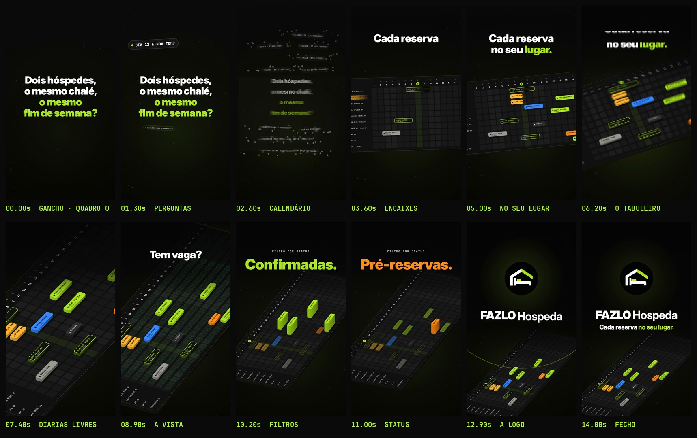

# FAZLO Hospeda — Reel 02 · CORTE CURTO · "Dois hóspedes, o mesmo chalé, o mesmo fim de semana?"

Versão de 15 s de "Cada reserva no seu lugar." ([`../reel-02/`](../../reel-02), que **não é alterado**), para medir o gancho com quem não segue a conta. Abre com a dor, sem nome de funcionalidade, e fecha só com **"Cada reserva no seu lugar."** + a logo, **sem domínio do site e sem CTA**.

**Formato:** 9:16 (1080×1920), **15,0 s** (35 tempos a 140 BPM), 60 fps, H.264 + AAC 48 kHz, **−14 LUFS**, pico real abaixo de −1 dBTP. A trilha e os efeitos são os do original, sem música do Instagram.

▶ **Vídeo:** [`output/fazlo-hospeda-reel-02-curto.mp4`](output/fazlo-hospeda-reel-02-curto.mp4) · 🖼 **Capa:** [`output/capa.jpg`](output/capa.jpg) · [`output/capa.png`](output/capa.png) · na grade: [`output/revisao/capa-no-feed.jpg`](output/revisao/capa-no-feed.jpg) · **Storyboard:** [`output/storyboard.jpg`](output/storyboard.jpg) · **Revisão:** [`output/revisao/`](output/revisao)

## Como é feito: remapeamento de tempo

Nada é redesenhado:
- **Motor:** `src/anim.js` é cópia idêntica do motor do Reel 02.
- **Trechos:** [`src/mapa.json`](src/mapa.json) liga cada trecho do vídeo novo a um trecho do original.
- **Textos:** [`src/teste.js`](src/teste.js) aplica as trocas de texto na leitura do motor.

| Vídeo novo | Original | Trecho |
|---|---|---|
| 0–1,714 s | 0–1,714 s | **Gancho** já inteiro no quadro 0: "Dois hóspedes," / "o mesmo chalé," (brancas) / "o mesmo" / "fim de semana?" (limão), **4 linhas no mesmo corpo (100 px)**, no vão livre entre os grupos de perguntas dos hóspedes, que seguem pipocando em volta. |
| 1,714–9,857 s | 2,571–10,714 s | **As perguntas viram o calendário:** o estilhaço, as 12 reservas se encaixando no tabuleiro ("Cada reserva no seu lugar."), o drop em 3D e o feixe que acende as diárias livres ("Tem vaga? Está à vista."). |
| 9,857–11,571 s | 15,429–17,143 s | **Os filtros:** cada status sobe em torres ("Confirmadas." e "Pré-reservas."). |
| 11,571–15,0 s | 23,143–26,571 s | **Fecho:** a logo entra com a sineta, "FAZLO Hospeda" + **"Cada reserva no seu lugar."**; fade nos últimos 0,3 s (14,7–15 s). |

Ajuste de 22/10: as linhas do gancho têm o **mesmo corpo** (antes, a 3ª saía bem menor que as duas primeiras); a frase em limão foi quebrada em "o mesmo" / "fim de semana?". Trocas: o título do gancho; sai a linha "GESTÃO DE RESERVAS" e sai o botão "CONHEÇA O SISTEMA · LINK NA BIO". Ficou de fora também o trecho do voucher (tem nome de hóspede de demonstração). Todos os cortes caem num tempo da música (0,42857 s) nos dois relógios.

## Som

[`scripts/trilha.py`](scripts/trilha.py) segue quatro passos:
1. **Mixagem:** refaz a mixagem do original (`scripts/audio.py`, o mesmo do Reel 02; aceita só caminhos de entrada e saída como argumento) **sem os sons do que o corte tirou**: a digitação de "GESTÃO DE RESERVAS" e o pop do CTA.
2. **Cortes:** recorta a mixagem nos mesmos pontos da imagem, com **crossfade de igual potência de 30 ms que termina no corte**.
3. **Final:** aplica o fade junto com a imagem e volta a −14 LUFS, com limitador de pico real.
4. **Cues:** remonta o `audio/cues.json` no tempo novo (58 eventos).

Ordem: `render.cjs cues` → `trilha.py` → `render.cjs video`.

## Capa

Preta, como as dos Reels:
- **logo** pequena no topo, no centro (y 330–382);
- **gancho** em 4 linhas **no mesmo corpo (110 px)**, as duas primeiras brancas e as duas últimas ("o mesmo" / "fim de semana?") limão, **centralizado na vertical do recorte 3:4** (bloco em y 730–1190, centro em 960,0);
- **um pedaço do tabuleiro do próprio vídeo** embaixo, com as reservas em blocos (o quadro de 7,4 s do motor, sem título, com as bordas esmaecidas). O `anim.js` é só lido.

Passa na regra fixa das capas ([`../README.md`](../../README.md)): recorte 3:4 com folga de 60 px (conteúdo em x 87–969, y 341–1496), canto do play livre, faixa do contador livre, sem sobreposição.

## Revisão

`python3 scripts/qa.py` gera [`relatorio-tecnico.txt`](output/revisao/relatorio-tecnico.txt), [`sincronia.txt`](output/revisao/sincronia.txt) e [`zonas-seguras.jpg`](output/revisao/zonas-seguras.jpg).

- **Técnica:**
  - 1080×1920, 60 fps (900 quadros), H.264 High yuv420p, AAC 48 kHz estéreo;
  - 15,000 s de vídeo e de áudio (Δ 0 ms), 12,0 MB;
  - **−14,1 LUFS**, pico real **−2,8 dBTP**;
  - sem trechos pretos (fora o fade final) nem imagem congelada; o 1º quadro já tem o título.
- **Cortes e textos:**
  - os 3 cortes caem no tempo da música, com crossfade de 30 ms;
  - o título do gancho (4 linhas, todas em 100 px, em y 697–1116 e x 174–906) fica fora da coluna de botões e da faixa de baixo;
  - o fecho não tem o botão do CTA (0 pixel limão), nem "GESTÃO DE RESERVAS", nem domínio.
- **Sincronização:**
  1. o áudio do MP4 é o `trilha.wav`, sem deslocamento;
  2. o corte não muda o ataque de nenhum dos 6 efeitos-chave (diferença para o original: média de 1,2 ms e máxima de 2,1 ms), e todos têm ataque a ≤ 9,3 ms do instante do evento;
  3. a imagem reage nos 4 golpes principais.
  Os "snap" dos encaixes (colcheias e semicolcheias em fila) ficam fora da medição: o detector confunde um com o vizinho, no original também. Eles entram na trilha normalmente.
