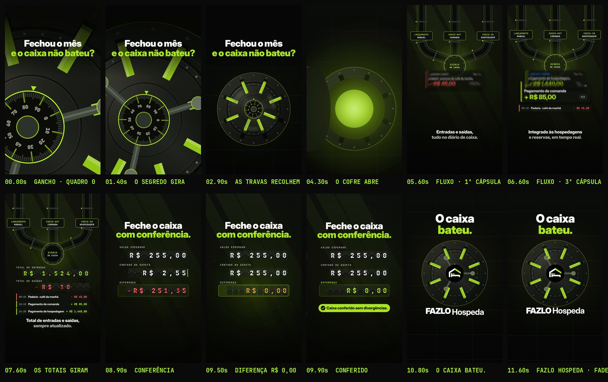

# FAZLO Hospeda — Reel 03 · TESTE (Trial Reel, 12 s) · "Fechou o mês e o caixa não bateu?"

Versão curta do "Controle de caixa" ([`../reel-03/`](../../reel-03), que **não é alterado**), para medir o gancho com quem não segue a conta. O original teve 90% de pulo: abria com o nome da funcionalidade e durava 30 s. Este tem **12 s** e abre com a dor. Vai ao ar como **Trial Reel** (não aparece na grade, então não tem capa).

**Formato:** 9:16 (1080×1920), **12,0 s**, 60 fps, H.264 + AAC 48 kHz, **−14 LUFS**, pico real abaixo de −1 dBTP. A trilha e os efeitos são os do original, sem música do Instagram.

▶ **Vídeo:** [`output/fazlo-hospeda-reel-03-teste.mp4`](output/fazlo-hospeda-reel-03-teste.mp4) · **Storyboard:** [`output/storyboard.jpg`](output/storyboard.jpg) · **Revisão:** [`output/revisao/`](output/revisao)

## Como é feito: remapeamento de tempo

Nada é redesenhado:
- **Motor:** `src/anim.js` é uma cópia idêntica do motor do Reel 03.
- **Trechos:** [`src/mapa.json`](src/mapa.json) liga cada trecho do vídeo novo a um trecho do original.
- **Textos:** [`src/teste.js`](src/teste.js) aplica três trocas de texto na leitura do motor:
  1. o gancho "FIM DO EXPEDIENTE / O caixa bateu?" vira **"Fechou o mês"** (branco) / **"e o caixa não bateu?"** (limão), em Inter Display 900 no maior corpo que cabe (103 px; a 2ª linha ocupa x 67–1013), já inteiro no quadro 0;
  2. a assinatura perde "CONTROLE DE CAIXA";
  3. e o "Acesse fazlohospeda.com.br" (teste de gancho, sem CTA).
- **Final:** fade para o preto nos últimos 0,3 s.

| Vídeo novo | Original | Trecho |
|---|---|---|
| 0–4,5 s | 0–4,5 s | **Gancho** (o segredo do cofre em close, girando) e **o cofre abre** (volante, travas recolhendo, luz vazando). O drop "CONTROLE DE CAIXA" (original 4,5–6 s) fica de fora. |
| 4,5–6 s | 8–9,5 s | **O fluxo:** a 1ª cápsula chega ao DIÁRIO DE CAIXA. |
| 6–8 s | 11,5–13,5 s | **O fluxo:** a 3ª cápsula, os cartões descem e os totais giram. |
| 8–10 s | 18,5–20,5 s | **A conferência:** o valor digitado, a diferença zerando em **R$ 0,00** com os sinos e "Caixa conferido sem divergências." |
| 10–12 s | 26–28 s | **Fechamento:** "O caixa bateu." + logo oficial + FAZLO Hospeda, com a sineta; fade nos últimos 0,3 s. |

Todos os cortes caem em múltiplos de 0,5 s (um tempo a 120 BPM), no vídeo novo e no original.

## Som

[`scripts/trilha.py`](scripts/trilha.py) segue quatro passos:
1. **Mixagem:** refaz a mixagem do original (`scripts/audio.py`, o mesmo do Reel 03; só aceita caminhos de entrada e saída como argumento) **sem os sons do que o teste tirou**: a digitação de "CONTROLE DE CAIXA", o domínio e a subida das linhas do título antigo.
2. **Cortes:** recorta a mixagem nos mesmos pontos da imagem, com **crossfade de igual potência de 30 ms** em cada corte.
3. **Final:** aplica o fade junto com a imagem e volta a −14 LUFS, com limitador de pico real.
4. **Cues:** remonta o `audio/cues.json` no tempo novo (51 eventos), para a revisão de sincronia.

## Revisão

`python3 scripts/qa.py` gera [`relatorio-tecnico.txt`](output/revisao/relatorio-tecnico.txt), [`sincronia.txt`](output/revisao/sincronia.txt) e [`zonas-seguras.jpg`](output/revisao/zonas-seguras.jpg).

- **Técnica:**
  - 1080×1920, 60 fps (720 quadros), H.264 High yuv420p, AAC 48 kHz estéreo;
  - 12,000 s de vídeo e de áudio (Δ 0 ms), 8,6 MB;
  - **−14,1 LUFS**, pico real **−3,6 dBTP**;
  - sem trechos pretos (fora o fade final) nem imagem congelada; o 1º quadro já tem o título.
- **Cortes e textos:**
  - os 4 cortes caem no tempo da música, com crossfade de 30 ms;
  - nenhum nome de funcionalidade nem CTA.
- **Áreas seguras:** o título do gancho fica em y 397–586, longe da coluna de botões (x ≥ 950, y 1060–1560) e da faixa de baixo (y ≥ 1560).
- **Sincronização:**
  1. o áudio do MP4 é o `trilha.wav`, sem deslocamento;
  2. o ataque de 18 efeitos-chave (travas, drop, cápsulas, teclas, zero e sineta) cai no instante do evento, com **desvio médio de 4,9 ms e máximo de 6,8 ms**;
  3. a imagem reage nos 5 golpes principais.
