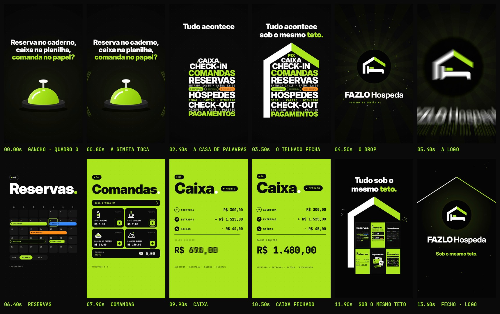

# FAZLO Hospeda — Reel 00 · CORTE CURTO · "Reserva no caderno, caixa na planilha, comanda no papel?"

Versão de 15 s de "Sob o mesmo teto." ([`../reel-00/`](../reel-00), que **não é alterado**), para medir o gancho com quem não segue a conta. Abre com a dor, sem nome de funcionalidade, e fecha só com **"Sob o mesmo teto."** + a logo, **sem domínio do site e sem CTA**.

**Formato:** 9:16 (1080×1920), **15,0 s** (32 tempos a 128 BPM), 60 fps, H.264 + AAC 48 kHz, **−14 LUFS**, pico real abaixo de −1 dBTP. A trilha e os efeitos são os do original, sem música do Instagram.

▶ **Vídeo:** [`output/fazlo-hospeda-reel-00-curto.mp4`](output/fazlo-hospeda-reel-00-curto.mp4) · 🖼 **Capa:** [`output/capa.jpg`](output/capa.jpg) · [`output/capa.png`](output/capa.png) · na grade: [`output/revisao/capa-no-feed.jpg`](output/revisao/capa-no-feed.jpg) · **Storyboard:** [`output/storyboard.jpg`](output/storyboard.jpg) · **Revisão:** [`output/revisao/`](output/revisao)

## Como é feito: remapeamento de tempo

Nada é redesenhado:
- **Motor:** `src/anim.js` é cópia idêntica do motor do Reel 00.
- **Trechos:** [`src/mapa.json`](src/mapa.json) liga cada trecho do vídeo novo a um trecho do original.
- **Textos:** [`src/teste.js`](src/teste.js) aplica as trocas de texto na leitura do motor.

| Vídeo novo | Original | Trecho |
|---|---|---|
| 0–1,875 s | 0–1,875 s | **Gancho** já inteiro no quadro 0: "Reserva no caderno," (branco) / "caixa na planilha," (branco) / "comanda no papel?" (limão), 96 px, com a sineta tocando embaixo. O golpe vai na 3ª linha e o sublinhado no 3º tempo. O mergulho pelo "o" de "pousada?" sai (era da palavra antiga). |
| 1,875–3,75 s | 3,75–5,625 s | **A casa de palavras:** o telhado fecha ("Tudo acontece sob o mesmo teto."). |
| 3,75–7,031 s | 7,5–10,781 s | **O drop:** a logo explode, a câmera mergulha e chega em **01 Reservas** (o calendário). |
| 7,031–8,906 s | 15,0–16,875 s | **04 Comandas.** |
| 8,906–10,781 s | 18,75–20,625 s | **06 Caixa:** ABERTO, entradas e saídas, saldo R$ 1.480,00, FECHADO. |
| 10,781–12,188 s | 20,625–22,031 s | **A casa inteira:** os seis cômodos sob o mesmo teto. |
| 12,188–15,0 s | 24,375–27,188 s | **Fecho:** "FAZLO Hospeda" + **"Sob o mesmo teto."**; fade nos últimos 0,3 s (14,7–15 s). |

Trocas na assinatura: "Sob o mesmo teto." no lugar de "Tudo sob o mesmo teto."; sai a linha "SISTEMA DE GESTÃO PARA POUSADAS" e sai o botão "SAIBA MAIS NO LINK DA BIO". Todos os cortes caem num tempo da música (0,46875 s) nos dois relógios.

## Som

[`scripts/trilha.py`](scripts/trilha.py) segue quatro passos:
1. **Mixagem:** refaz a mixagem do original (`scripts/audio.py`, o mesmo do Reel 00; aceita só caminhos de entrada e saída como argumento) **sem os sons do que o corte tirou**: o "rise" do título antigo, o "drop" e o "zoom" do mergulho pelo "o", a digitação do descritivo e o pop do CTA.
2. **Cortes:** recorta a mixagem nos mesmos pontos da imagem, com **crossfade de igual potência de 30 ms que termina no corte**. Assim o trecho que entra já vem a pleno no instante do corte e o ataque do "boom" do drop não é suavizado.
3. **Final:** aplica o fade junto com a imagem e volta a −14 LUFS, com limitador de pico real.
4. **Cues:** remonta o `audio/cues.json` no tempo novo (61 eventos).

Ordem: `render.cjs cues` → `trilha.py` → `render.cjs video`.

## Capa

Preta, como as dos Reels:
- **logo** pequena no topo, no centro (y 330–382);
- **título-gancho** em 3 linhas (96→112 px, Inter Display 900; as duas primeiras brancas, a 3ª limão), **centralizado na vertical do recorte 3:4** (bloco em y 813–1107, centro em 960,0);
- **a sineta do primeiro quadro do vídeo**, tocando embaixo, desenhada pelo próprio motor (`drawBell`) com as ondas sonoras. O `anim.js` é só lido.

Passa na regra fixa das capas ([`../README.md`](../README.md)): recorte 3:4 com folga de 60 px (conteúdo em x 93–988, y 341–1522), canto do play livre, faixa do contador livre, sem sobreposição. A prévia na grade mostra a capa ao lado da do ep-05 da série Rotina e da do Reel 00.

## Revisão

`python3 scripts/qa.py` gera [`relatorio-tecnico.txt`](output/revisao/relatorio-tecnico.txt), [`sincronia.txt`](output/revisao/sincronia.txt) e [`zonas-seguras.jpg`](output/revisao/zonas-seguras.jpg).

- **Técnica:**
  - 1080×1920, 60 fps (900 quadros), H.264 High yuv420p, AAC 48 kHz estéreo;
  - 15,000 s de vídeo e de áudio (Δ 0 ms), 11,3 MB;
  - **−14,2 LUFS**, pico real **−3,9 dBTP**;
  - sem trechos pretos (fora o fade final) nem imagem congelada; o 1º quadro já tem o título.
- **Cortes e textos:**
  - os 6 cortes caem no tempo da música, com crossfade de 30 ms;
  - o título do gancho (y 490–785) fica fora da coluna de botões e da faixa de baixo;
  - o fecho não tem o botão do CTA (0 pixel limão na região), nem domínio, nem descritivo.
- **Sincronização:**
  1. o áudio do MP4 é o `trilha.wav`, sem deslocamento;
  2. o corte não muda o ataque de nenhum dos 11 efeitos-chave (diferença para o original: média de 1,6 ms e máxima de 5 ms); a mediana do ataque é de 6,8 ms, e o "boom" do drop e o "ding" da assinatura têm ~26 ms no próprio Reel 00 (o corpo do golpe vem depois do instante do evento);
  3. a imagem reage nos 6 golpes principais.
