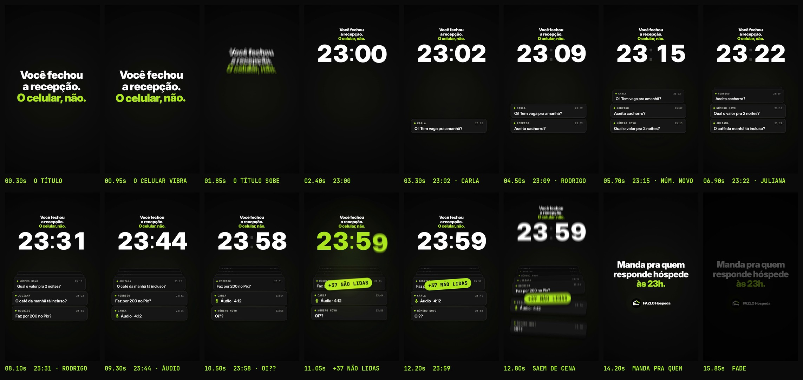

# FAZLO Hospeda — Reel 08 · Pilar ROTINA · "Você fechou a recepção. O celular, não."

Segundo vídeo do pilar **ROTINA** (identificação com a rotina do gestor, sem funcionalidades do sistema e sem CTA comercial). Mesmo tema do "Tem vaga pro fim de semana?" do Reel 02 — as mensagens de hóspedes —, com mecânica nova: lá as perguntas viravam um calendário; aqui é o tempo que passa e as mensagens que se acumulam. Postagem prevista: sábado, 17/10.

Peça independente: nada aqui altera os Reels anteriores, os Stories ou o carrossel.

**Formato:** 9:16 (1080×1920), **16,0 s**, 60 fps, H.264 + AAC 48 kHz. **Só efeitos sonoros** (a música entra pelo Instagram); o vídeo funciona sem ela.

▶ **Vídeo:** [`output/fazlo-hospeda-reel-08.mp4`](output/fazlo-hospeda-reel-08.mp4) · **com voz (teste de narração):** [`output/fazlo-hospeda-reel-08-voz.mp4`](output/fazlo-hospeda-reel-08-voz.mp4)
🖼 **Capa:** [`output/capa.jpg`](output/capa.jpg) · [`output/capa.png`](output/capa.png) · prévia na grade: [`output/revisao/capa-no-feed.jpg`](output/revisao/capa-no-feed.jpg)
Storyboard: [`output/storyboard.jpg`](output/storyboard.jpg) · Revisão: [`output/revisao/`](output/revisao)



---

## Conceito: o relógio de plantão

Um relógio digital gigante avança de **23:00 a 23:59**. A cada salto de minuto chega a mensagem de um hóspede, num card; os cards se empilham embaixo do relógio e os mais antigos sobem e se comprimem, dando a sensação de acúmulo. Às 23:59, o chip **"+37 NÃO LIDAS"** é carimbado em cima da pilha. Fica o convite: "Manda pra quem responde hóspede às 23h."

Sem telas, celulares ou interface de app: só cards soltos sobre o preto (`#161616`, borda `#3A3A3A`, ponto limão), sem balões, sem tiques de lido e sem emojis.

Mensagens (exatamente como no roteiro):

```
23:02 · CARLA ........ Oi! Tem vaga pra amanhã?
23:09 · RODRIGO ...... Aceita cachorro?
23:15 · NÚMERO NOVO .. Qual o valor pra 2 noites?
23:22 · JULIANA ...... O café da manhã tá incluso?
23:31 · RODRIGO ...... Faz por 200 no Pix?
23:44 · CARLA ........ [microfone em vetor] Áudio · 4:12
23:58 · NÚMERO NOVO .. Oi??
```

## Roteiro

| Tempo | Cena | O que acontece |
|---|---|---|
| 0–1,6 s | **Título** | "Você fechou / a recepção." (branco) e "O celular, não." (limão), 124 px, **já no quadro 0** (vale como capa), com aproximação lenta. Em 0,8 s "O celular, não." **vibra** 0,3 s, com um zumbido curto. |
| 1,6–2,6 s | **O relógio entra** | O título sobe e encolhe para o cabeçalho (y ≈ 265–410); o "23:00" (Inter Display 900, 270 px) entra com os dígitos subindo por trás de uma máscara. Os dois pontos piscam no ritmo de um segundo. |
| 2,6–11 s | **Sete mensagens** | Uma a cada 1,2 s (2,6 · 3,8 · 5,0 · 6,2 · 7,4 · 8,6 · 9,8 s). Nos 0,3 s anteriores os minutos giram até o horário da mensagem e param junto com a chegada do card, que sobe de baixo; o ponto limão pulsa. Os anteriores sobem uma casa; do 3º em diante se comprimem (95% → 76%), escurecem e se sobrepõem. O áudio da Carla traz o microfone desenhado em vetor; o "Oi??" chega com um tremor curto. |
| 11,0 s | **+37 NÃO LIDAS** | O relógio vai a **23:59** e o chip limão é carimbado (de 1,6×, −4°) em cima da pilha; a pilha inteira leva um tranco com mola e o relógio pisca entre branco e limão até 12,6 s. |
| 12,6–13,0 s | **Sai de cena** | Os cards caem pela parte de baixo, em cascata; relógio e cabeçalho saem pelo topo. |
| 12,9–13,34 s | **Mensagem** | "Manda pra quem / responde hóspede" (branco) / "às 23h." (limão), 100 px, linha a linha. |
| 13,5 s | **Logo** | Símbolo oficial (112 px) + "FAZLO Hospeda" (42 px), com a sineta da série. |
| 13,34–15,6 s | **Leitura** | A mensagem fica **~2,3 s parada** antes do fade. |
| 15,6–16,0 s | **Fade** | Fade curto para preto (imagem e som). |

## Tamanhos, leitura e áreas seguras

- **Relógio:** 270 px, dígitos em casas de largura fixa (o relógio não "treme" quando os números mudam), y ≈ 455–650.
- **Cards:** 860×156 px (x 80–940). Nome em JetBrains Mono 30 px (`#B9B9B1`), horário em mono 28 px à direita, mensagem em Inter Display 46 px (a mais longa, ~585 px, cabe numa linha). Cada card fica **~2,4 s em tamanho cheio** (1,2 s na casa de baixo + 1,2 s na de cima) antes de comprimir.
- **Áreas seguras:** todo o conteúdo entre y 265 e 1456 — dentro do recorte central 3:4 (y 240–1680) e a 100 px da faixa inferior do Instagram (1560). Na faixa dos botões à direita (x ≥ 950, y 1060–1560) os cards terminam em x 940 e o texto em x ≤ 900; o título de abertura é centrado em x = 530 para "não." terminar em x ≈ 916.
- Verificação: [`zonas-seguras.jpg`](output/revisao/zonas-seguras.jpg) e [`recorte-3x4.jpg`](output/revisao/recorte-3x4.jpg).

## Som

Efeitos **sintetizados do zero** (numpy/scipy), sem samples e sem música:

- **Ping** a cada mensagem: seno suave com um leve brilho, decaimento curto — genérico, sem timbre de app —, subindo na pentatônica **Dó5 → Ré6** (Dó5, Ré5, Mi5, Sol5, Lá5, Dó6, Ré6); "Oi??" chega com dois pings.
- **Vibração** do título: zumbido grave pulsando, 0,3 s.
- **Carimbo do +37:** baque grave, zumbido de vibração e a pilha chacoalhando.
- **Discretos:** sopros na subida do título, na entrada do relógio, na saída dos cards e na mensagem; tom de sala quase inaudível (−56 dB).
- **Marca:** a **sineta de recepção da série**, em Sol, discreta.
- **Master:** **−16 LUFS** integrado (pilar ROTINA), limitador de pico real; a animação exporta `audio/cues.json` e `audio.py` coloca cada som nesses instantes.

## Revisão

`python3 scripts/qa.py` gera [`relatorio-tecnico.txt`](output/revisao/relatorio-tecnico.txt), [`sincronia.txt`](output/revisao/sincronia.txt), [`zonas-seguras.jpg`](output/revisao/zonas-seguras.jpg) e [`recorte-3x4.jpg`](output/revisao/recorte-3x4.jpg).

**Técnica:** 1080×1920, 60 fps (960 quadros), H.264 High yuv420p, AAC 48 kHz estéreo, 16,000 s de vídeo e de áudio (Δ 0 ms), **−16,1 LUFS**, pico real **−2,4 dBTP** no MP4, 5,3 MB, sem trechos pretos (fora o fade final) nem imagem congelada, 1º quadro já com o título.

**Sincronização, em três camadas:**

1. o áudio dentro do MP4 é o `efeitos.wav`, sem deslocamento (0,0 ms na 2ª e na 5ª mensagens e no carimbo);
2. o ataque de 9 efeitos (os 7 pings, o carimbo e a sineta) cai no instante do evento visual: **desvio médio de 5,4 ms e máximo de 6,8 ms**, menos de meio quadro;
3. a imagem reage nos 9: o card novo aparece embaixo a cada ping, o carimbo no próprio quadro do som e a logo a 6 quadros.

**Visual:** revisão quadro a quadro durante a produção. Ajuste feito a partir dela: o título de abertura, em 136 px, fazia "não." invadir a coluna de botões do Reels; foi para 124 px e centrado em x = 530.

## Versão com voz (teste de narração, ElevenLabs)

Primeiro teste de narração na @fazlohospeda: um arquivo **novo**, [`output/fazlo-hospeda-reel-08-voz.mp4`](output/fazlo-hospeda-reel-08-voz.mp4). A versão sem voz continua igual, e a imagem do MP4 com voz é uma cópia exata da dela (mesmo fluxo de vídeo, sem recodificar); os textos na tela continuam.

- **Voz:** Raquel - For Conversational (`GDzHdQOi6jjf8zaXhCYD`), a voz oficial da FAZLO (a mesma da @fazlodigital) — português do Brasil, tom de conversa, não de locutor.
- **Modelo:** `eleven_multilingual_v2`. **Ajustes:** estabilidade 0,40 · semelhança 0,80 · estilo 0,35 · *speaker boost* ligado · velocidade 1,0 (a voz não é acelerada) · seed 808.
- **Geração:** uma chamada por cena, com as falas vizinhas como contexto (`previous_text` / `next_text`) e os tempos de cada caractere (`with-timestamps`). Formato: MP3 44,1 kHz 128 kb/s (o único que o plano libera; PCM e MP3 192 kb/s são recusados).
- **Chave:** não fica no repositório nem é impressa. Nesta nuvem, a rede põe a chave no cabeçalho `xi-api-key` (Segredos de rede); fora dela, `scripts/voz.py` lê a variável de ambiente `ELEVENLABS_API_KEY`.

**Roteiro A (aprovado), em velocidade 1,0:**

| Cena | Na tela | Fala | Entra |
|---|---|---|---|
| Título | "Você fechou a recepção. O celular, não." | "Você fechou a recepção… O celular, não." | 0,05–2,76 s |
| Mensagens | relógio + as 7 mensagens (2,6–9,8 s) | "Onze da noite: tem vaga pra amanhã? Aceita cachorro? Faz por duzentos no Pix? E chega um áudio de quatro minutos." | 2,88–10,65 s |
| +37 NÃO LIDAS | o carimbo (11,0 s) | "Trinta e sete não lidas." | 11,05–12,39 s |
| Convite + logo | "Manda pra quem responde hóspede às 23h." + logo (13,5 s) | "Manda pra quem responde hóspede às onze. FAZLO Hospeda." | 12,52–15,52 s |

- **Para caber sem acelerar:** a fala das mensagens, inteira, dava 9,4 s para 7,8 s; entrou a versão sem "E ainda" (8,5 s), como combinado. Depois, só as pausas entre as frases ficaram um pouco mais curtas (cortes no meio do silêncio, com transição de 20 ms): "recepção…" 0,49 → 0,40 s; "noite:" 0,81 → 0,50; "amanhã?" 0,33 → 0,26; "cachorro?" 0,40 → 0,30; "Pix?" 0,69 → 0,42; "onze." 0,36 → 0,32 (com uma pausa de 0,25 s marcada antes da marca, `<break>`, só no texto enviado).
- **Pronúncia:** FAZLO e Hospeda foram enviados como estão escritos. Medição no áudio (Praat), comparando com versões de controle da mesma voz ("Ospéda" e "hóspeda", "Fázlo" e "Fazlô"): em **Hospeda**, a sílaba "pe" é a mais longa (162 ms × 151 ms de "os"), com a queda de tom da sílaba tônica e um "e" pleno e aberto (F1 563 Hz, F2 1860 Hz) — o mesmo desenho de "Ospéda" e o oposto de "hóspeda" (que reduz o "e": F1 411, F2 1694) → **os-PÉ-da**; em **FAZLO**, "FAZ" dura 232 ms e "lo" 93 ms, a proporção de "Fázlo" (e não a de "Fazlô") → **FÁZ-lo**. Nenhuma grafia trocada.

**Mixagem:** não há música no Reel 08; quem abaixa sob a voz são os efeitos (`audio/efeitos.wav`): **−9,5 dB** enquanto a voz fala (ataque 60 ms, retorno 300 ms; voltam ao nível do vídeo nas pausas). O carimbo do +37 bate antes da fala entrar. Master **−14 LUFS** integrado, pico real **−1,9 dBTP** no MP4 (limitador a −2 dBTP antes do AAC). Conferência em [`voz-mix.txt`](output/revisao/voz-mix.txt) e [`voz-linha-do-tempo.png`](output/revisao/voz-linha-do-tempo.png) (efeitos antes e depois, a voz por cena e os eventos da imagem).

```bash
python3 scripts/voz.py        # as 4 falas -> audio/voz/ (cena-1..4.wav + falas.json com os tempos de cada caractere)
python3 scripts/mix_voz.py    # mixagem + master + output/fazlo-hospeda-reel-08-voz.mp4 + conferência
```

## Capa

A cena do carimbo (11 s), compacta, no fundo preto da série (`#0A0A0A`) com o brilho limão discreto das outras capas:

1. **Logo** no alto, ao centro: o símbolo oficial + "FAZLO Hospeda" (como nas capas novas dos Reels 06, 05 e 02).
2. **Título** em Inter Display Black, 128 px, centralizado: "Você fechou / a recepção." em branco e "O celular, não." em limão.
3. **O relógio** marcando **23:59** em 252 px (no vídeo, 270), com a **pilha de mensagens** comprimida atrás dele — 3 cards, os de trás quase apagados, só a ideia do acúmulo — e o chip limão **"+37 NÃO LIDAS"** carimbado por cima, inclinado −4°, como no vídeo.

O relógio e os cards são desenhados pelo próprio motor (`clock()` no instante 11,25 s e `cardBody()`); `src/capa.html` lê o `anim.js` como texto e o avalia com uma linha a mais que expõe essas peças — o arquivo do motor e os vídeos (com e sem voz) não mudam. Sem celular, tela, balão, tique de lido ou emoji.

Segue a **regra fixa das capas** ([`../README.md`](../README.md)): o bloco título + relógio + pilha + chip (y 558–1362) fica **centralizado na vertical do recorte 3:4** (centro em y = 960); tudo dentro do recorte com folga de 60 px; canto do play e faixa do contador livres; nada cortado nem sobreposto (a pilha é fundo: fica atrás do relógio e do chip de propósito). Conferência em [`capa.txt`](output/revisao/capa.txt) e [`capa-no-feed.jpg`](output/revisao/capa-no-feed.jpg), com a capa na grade ao lado do Carrossel 01 e do Reel 07.

```bash
node scripts/capa.cjs                                                               # output/capa.png + revisao/capa-caixas.json
python3 ../tools/revisao_capa.py . --vizinhos ../../carrosseis/carrossel-01 ../reel-07   # capa.jpg + prévia + conferência
```

## Arquivos-fonte

```
reels/reel-08/
  src/
    index.html                 # preview (play/scrub com áudio) e página usada no render
    capa.html + capa.js        # a capa (página própria; lê o anim.js sem alterá-lo)
    anim.js                    # TODO o motion: título, relógio, cards e pilha, carimbo, saída, mensagem, logo, cues
    assets/                    # logo oficial + a mesma logo sem o fundo branco externo
    fonts/                     # Inter Display + JetBrains Mono (licença OFL)
  scripts/
    render.cjs                 # cues | video | stills (Chromium headless -> ffmpeg)
    capa.cjs                   # a capa -> output/capa.png + revisao/capa-caixas.json
    audio.py                   # efeitos a partir de audio/cues.json, master
    logo_alpha.py              # recorte do fundo da logo (não altera a arte)
    storyboard.py              # storyboard a partir do MP4
    qa.py                      # revisão técnica + sincronização + zonas seguras + recorte 3:4
    voz.py                     # narração (ElevenLabs): uma chamada por cena -> audio/voz/
    mix_voz.py                 # versão com voz: mixagem, master -14 LUFS e o MP4 novo
  audio/
    cues.json                  # eventos de som exportados da animação
    efeitos.wav
    voz/                       # as 4 falas geradas + falas.json (texto enviado, tempos de cada caractere)
    trilha-voz.wav             # voz + efeitos, master da versão com voz
  output/
    fazlo-hospeda-reel-08.mp4  # vídeo final
    fazlo-hospeda-reel-08-voz.mp4  # o mesmo vídeo com a narração (teste)
    capa.png / capa.jpg        # capa do Instagram (1080x1920)
    storyboard.jpg
    revisao/
```

```bash
cd reels/reel-08
node scripts/render.cjs cues                   # 1) eventos de som tirados da animação
python3 scripts/audio.py                       # 2) efeitos sonoros
node scripts/render.cjs video --fps 60         # 3) vídeo final em output/
python3 scripts/storyboard.py                  # 4) storyboard
python3 scripts/qa.py                          # 5) revisão técnica, sincronização e áreas seguras
node scripts/render.cjs stills 3.3,11.3        # (opcional) quadros avulsos em PNG
```

### Onde editar

- **Tempo:** `DURATION`, `MSG_T` (chegada de cada mensagem) e o objeto `T` no topo de `src/anim.js`; `ROLL` é o giro dos minutos antes de cada mensagem.
- **Mensagens:** `MSGS` (minuto, nome, texto; `audio` desenha o microfone, `shake` faz o card tremer).
- **Pilha:** `CARD`, `SLOT_Y` (topo de cada casa) e `SLOT_S` (escala de cada casa).
- **Relógio:** `CLOCK` (corpo e posição); o pisca do 23:59 e os dois pontos ficam em `clock()`.
- **Som:** mudar um tempo em `anim.js` e rodar `render.cjs cues` + `audio.py` já ressincroniza; notas dos pings em `PINGS`, timbres em `ping`, `buzz`, `stamp_hit` (`scripts/audio.py`).
