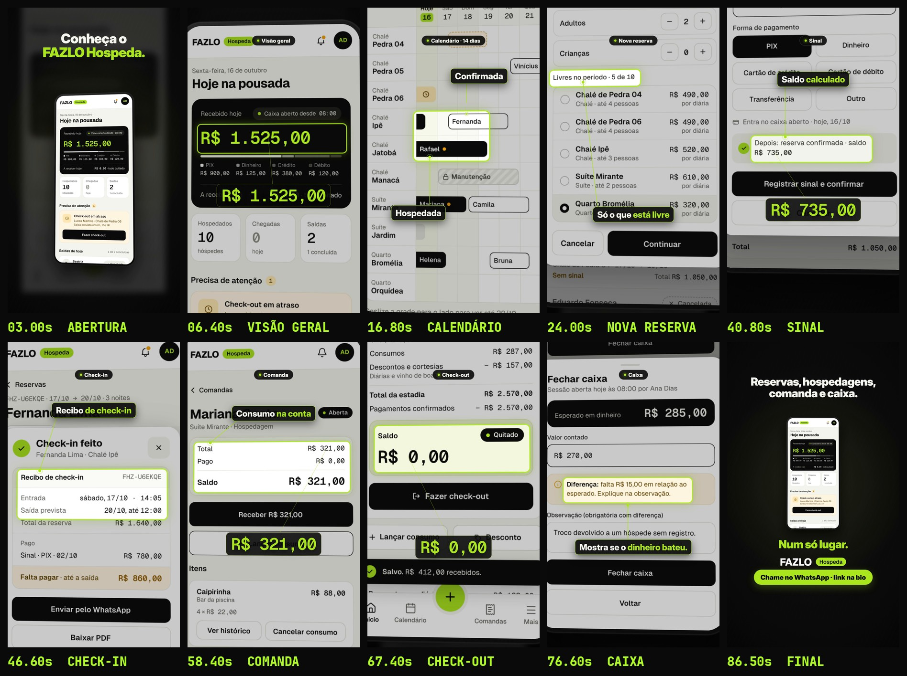

# FAZLO Hospeda — reel de apresentação (telas inteiras em funcionamento)

Reel 9:16 (1080×1920), **90,0 s**, 60 fps, H.264 + AAC, **sem voz**. É o primeiro vídeo da série sobre o Hospeda e mostra o app funcionando em um dia da Pousada Vale Sereno. Usa as telas reais do pacote `fazlo-hospeda-telas.zip` (`../_material`).

**Não publicar antes do OK.**

## Correções (base 699f3d5)

Roteiro, trilha, duração aproximada e final mantidos. Mudou só:

1. **Enquadramento.** O celular fica inteiro, com a moldura, em 100% do vídeo. O zoom máximo é 1,0× (limite 1,5×) e a tela tem sempre ≥ 40 px de margem dos lados. Nenhum texto da tela é cortado pela borda do vídeo; isso é medido em cada quadro.
2. **Lupa para ler.** Para ler algo pequeno, o celular diminui e desce, e uma lupa abre acima dele, fora da tela, ligada por uma linha fina ao ponto.
   - A lupa mostra o elemento inteiro ampliado (texto ≥ 40 px), nunca um pedaço cortado.
   - A câmera e as lupas são agendadas para que nenhuma lupa cubra a tela, nem nas transições.
   - Os valores grandes que "saltavam e contavam" saíram: agora quem mostra o valor é a lupa, com o elemento real.
3. **Destaque.** O contorno limão usa o retângulo real do bloco inteiro (`getBoundingClientRect`, com todos os filhos), com 12 px de folga e o raio do elemento + 12. O QA confere que o contorno contém 100% do elemento.
4. **Chip da seção** sempre acima do celular, na área preta (y 176–238). O topo do celular fica em y ≥ 262. Sobreposição com a tela: zero.
5. **Digitação no próprio campo.** "Bruno Teixeira" e "315,00" são escritos no input do HTML, letra a letra. Cada letra é um quadro da tela renderizado pelo Chromium (fonte, tamanho, cor e alinhamento do app), com o cursor piscando no fim. Nada é colado por cima.
6. **Rótulos = palavras da tela.** Cada rótulo é conferido contra o texto do HTML do estado. "Bloqueada" virou "Manutenção", e a barra do Rafael deu lugar à da Helena (Hospedada), que cabe inteira na lupa.

▶ **Vídeo:** [`output/apresentacao-hospeda.mp4`](output/apresentacao-hospeda.mp4)
- Storyboard: [`output/storyboard.jpg`](output/storyboard.jpg)
- Capa da grade: [`output/capa-grade.jpg`](output/capa-grade.jpg) · conferência: [`output/grade/revisao/capa-no-feed.jpg`](output/grade/revisao/capa-no-feed.jpg)
- Legenda: [`legenda.txt`](legenda.txt)
- Revisão técnica: [`output/revisao/relatorio.txt`](output/revisao/relatorio.txt)



## Linguagem

- **Sempre a tela inteira, dentro de um celular.** O celular tem moldura fina, cantos arredondados e nenhuma marca, em 3D leve: entra girando, inclina e se aproxima. Nenhuma peça é recortada para ficar solta (o que estava errado no "Um dia inteiro" e na "Parte 1").
- **Como as telas são feitas.** Os estados HTML do pacote são renderizados inteiros no Chromium em 4× (`scripts/telas.cjs`).
  - Nos estados com janela ou folha, sai o fundo do estado e a janela sozinha. A janela sobe de baixo dentro da tela, na mesma posição do estado original.
- **O app funciona na frente de quem assiste:**
  - toque com onda limão nos botões reais (posição pelos ids e textos do HTML), e o botão afunda;
  - troca de tela empurrando para o lado, janela e folha subindo, troca dos passos da nova reserva;
  - rolagem da Visão geral até "Precisa de atenção" e até a barra de baixo;
  - o nome do hóspede e o sinal sendo digitados;
  - estados antes → depois: pré-reserva → janela do sinal, check-in → check-in feito → hospedada, R$ 287,00 → R$ 321,00, R$ 412,00 → quitado, caixa aberto → fechado.
- **Câmera.** O celular fica sempre inteiro (máx. 1,0×). Para ler, entra a lupa. A ampliação da lupa vem do menor texto do elemento, para ficar ≥ 40 px no quadro.
- **Motion por cima:**
  - chip da seção no alto;
  - contorno limão no retângulo real do elemento lido;
  - lupa com rótulo curto (as palavras da tela, Inter Display 52 px) e linha fina limão até o ponto;
  - a tela anterior desfocada atrás.
- **Ritmo.** Trocas de 0,3–0,45 s; cada informação-chave fica parada ≥ 1,8 s.
- **Final próprio.** O celular se afasta e as telas do vídeo passam em fila por trás dele; ele volta para a Visão geral com "Reservas, hospedagens, comanda e caixa. Num só lugar.", a marca e a pílula. Nada da v2 (sem anel, sem órbita, sem a logo circular).

## Roteiro

| Tempo | Seção | Telas do pacote (estados) |
|---|---|---|
| 0–5 s | Abertura | O celular entra girando; Visão geral carregando → tela. "Conheça o FAZLO Hospeda." |
| 5–13 s | Visão geral | Recebido hoje **R$ 1.525,00** → Hospedados **10** · Saídas **2** → rola até "Precisa de atenção": **Check-out em atraso** → rola até a barra e toca em Calendário. |
| 13–21 s | Calendário | 14 dias. A câmera percorre a grade: Pré-reserva (Gustavo), Hospedada (Helena), Confirmada (Fernanda), Manutenção. |
| 21–33 s | Nova reserva | Toque no "+" → menu criar → Nova reserva. Passo 1: **Livres no período · 5 de 10**. Passos 2, 3 e 4 rápidos, com a barra de progresso andando e o nome digitado. Passo 5: **Total da reserva R$ 972,00** → Criar com sinal. |
| 33–41,3 s | Sinal | Gustavo Ribeiro, **Pré-reserva**, sem sinal → toque em Registrar sinal → janela com **R$ 315,00** digitado → "Depois: reserva confirmada · saldo **R$ 735,00**". |
| 41,3–51,5 s | Check-in | Janela "Fazer check-in" da Fernanda Lima (conferência) → toque → **Check-in feito** com recibo → Hospedagens: **Hospedada**. |
| 51,5–60,2 s | Comanda | Comanda da Mariana Costa: total **R$ 287,00** → Lançar consumo (2 águas e 1 caipirinha, R$ 34,00) → produto adicionado: total **R$ 321,00**. |
| 60,2–74,8 s | Check-out | Saldo **R$ 412,00** com "Fazer check-out" bloqueado ("Só libera com saldo zero.") → Receber no PIX → **R$ 0,00 Quitado** → encerrar → recibo da estadia. |
| 74,8–83,5 s | Caixa | Recebido por forma de pagamento **R$ 1.525,00** → Fechar caixa: contado R$ 270,00, "**falta R$ 15,00**" ("Mostra se o dinheiro bateu.") → caixa fechado. |
| 83,5–90 s | Final | Fila de telas atrás do celular → Visão geral → texto, marca e pílula "Chame no WhatsApp · link na bio". |

## Pontos a conferir

- **Comanda: R$ 321,00, não R$ 287,00.** No pacote, o estado "produto adicionado" (`08-comanda/04`) mostra o total R$ 321,00 (287 + 34). O vídeo segue os estados: R$ 287,00 em destaque antes de lançar, R$ 321,00 depois. O check-out (`07`/`09`) continua com consumos R$ 287,00, como no pacote. Se a ideia for terminar a comanda em R$ 287,00, a saída é não mostrar o "produto adicionado".
- **Datas do check-out.** Os estados `09` (saldo quitado, encerrar, recibo) mostram a saída "hoje, 18/10", como no pacote.
- **Menu "criar" sobre o calendário.** O estado `menu-criar` do pacote é desenhado sobre a Visão geral. No vídeo, a folha do menu sobe sobre o calendário, de onde saiu o toque no "+". A folha é a do pacote, na mesma posição.
- **Calendário no celular (14 dias).** Ele mostra até o dia 22. Os nomes das barras têm 11,5 px e são lidos na lupa.
- **Caixa.** A tela do caixa nunca rola. A linha do diário com o sinal do Gustavo está em y 1274 da página e fica fora da parte visível.
- **Áreas seguras.** Lupas, chip, textos, marca e pílula ficam fora dos 20% de baixo e da coluna de botões (x > 985, y > 1060). O celular inteiro fica acima de y 1536 (base máxima y 1532).

## Som

Trilha nova (`scripts/audio.py`): nu-disco a 120 BPM em Lá menor, diferente do 2-step da v2.
- Bumbo 4×4, palmas no 2 e no 4, chimbal aberto no contratempo.
- Baixo em oitavas, acordes curtos de serra e um arpejo nas seções do meio.
- Um respiro a cada 8 compassos.

Os efeitos são discretos e vêm de `audio/eventos.json`, exportado da animação:
- toques e trocas de tela;
- janelas;
- digitação (uma tecla por letra);
- cadeado abrindo;
- gaveta do caixa;
- a fila e a marca do final.

Master em −14 LUFS, pico ≤ −1,5 dBTP.

## Como renderizar

```bash
cd reels/telas/apresentacao
node scripts/telas.cjs                       # telas inteiras + janelas + caixas (só se o pacote mudar)
node scripts/render.cjs dados --fps 30       # eventos do som + dados do QA
python3 scripts/audio.py
node scripts/render.cjs video --workers 4    # output/apresentacao-hospeda.mp4
python3 scripts/storyboard.py
cd ../../.. && node reels/tools/capa_grade.cjs reels/telas/apresentacao \
  && python3 reels/tools/revisao_capa.py reels/telas/apresentacao --saida reels/telas/apresentacao/output/grade --vizinhos reels/telas/parte-1-chegada/output/grade
cd reels/telas/apresentacao && cp output/grade/capa.jpg output/capa-grade.jpg && python3 scripts/qa.py
```
