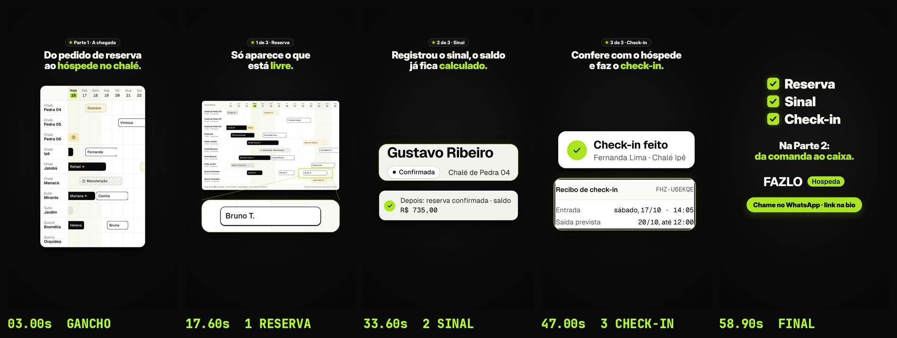

# FAZLO Hospeda — Parte 1 · "A chegada" (reel de telas)

Reel 9:16 (1080×1920), **59,4 s**, 60 fps, H.264 + AAC, **sem voz**. Cobre a Reserva, o Sinal e o Check-in, com as telas reais do pacote `fazlo-hospeda-telas.zip`. A Parte 2 (Comanda → Check-out → Caixa) vem depois.

**Não publicar antes do OK.**

▶ **Vídeo:** [`output/parte-1-chegada.mp4`](output/parte-1-chegada.mp4)
- Storyboard: [`output/storyboard.jpg`](output/storyboard.jpg)
- Capa da grade: [`output/capa-grade.jpg`](output/capa-grade.jpg) · conferência: [`output/grade/revisao/capa-no-feed.jpg`](output/grade/revisao/capa-no-feed.jpg)
- Legenda: [`legenda.txt`](legenda.txt)
- Revisão técnica: [`output/revisao/relatorio.txt`](output/revisao/relatorio.txt)



## O que mudou em relação ao "Um dia inteiro"

O "Um dia inteiro" (`../um-dia-inteiro`, commit `ac2db6b`) ficou como estava. Esta parte reaproveita dele o extrator de peças (`scripts/pecas.cjs`), o palco com perspectiva, as peças vivas, o odômetro e o toque. O resto foi refeito a partir da avaliação do Willian:

- **Ritmo.** Menos coisa por vez:
  - 3 etapas em vez de 6, com no máximo 2 peças na tela.
  - Cada peça fica parada ≥ 2,5 s depois de entrar, e cada valor ≥ 3 s.
  - Há ≥ 0,4 s de respiro entre uma ideia e a seguinte.
  - O sequenciador da animação (`src/anim.js`) calcula cada tempo a partir desses mínimos.
- **Espaço.**
  - 56 px entre as peças e 80 px de margem lateral.
  - O conteúdo fica centrado na altura útil (y 200–1536) e desce até o terço de baixo.
  - Para isso, as peças são grandes: o menor texto de cada uma tem ≥ 40 px no quadro.
  - Peças que descem abaixo de y 1060 terminam em x ≤ 985, fora da coluna de botões do Reels.
- **Visual próprio.** Nada da composição do v2 (sem anel, sem órbita, sem a logo circular, sem a tela inundada de limão).
  - Fio de luz: um ponto limão leva a ideia que sai até o lugar onde a próxima nasce.
  - Peças que entram do fundo, com foco e sombra suave.
  - Brilho sutil na peça em destaque.
  - Onda limão no toque.
  - Chips do pacote trocando de status numa íris.
  - Lupa que liga a visão geral do calendário à linha ampliada.
  - Final em lista vertical, com checks.

## Roteiro

| Tempo | Etapa | O que aparece |
|---|---|---|
| 0–4,1 s | **Gancho** | Chip "Parte 1 · A chegada". "Do pedido de reserva ao hóspede no chalé." O calendário de 14 dias (`02-calendario`, celular) se enche de barras, uma a uma. |
| 4,1–19,4 s | **1 Reserva** | "Só aparece o que está livre." **a)** Entrada 22/10/2026 e Saída 25/10/2026. **b)** "Livres no período · 5 de 10" com a lista. O Quarto Bromélia (R$ 320,00 por diária) é tocado e selecionado. **c)** A visão de 14 dias (computador) com a lupa no Quarto Bromélia, de 22 a 25. Na linha ampliada, a barra **Bruno T.** cai no lugar; ao mesmo tempo, aparece na visão geral. |
| 19,4–36,3 s | **2 Sinal** | "Registrou o sinal, o saldo já fica calculado." Só o Gustavo Ribeiro. **a)** Cartão com o chip **Pré-reserva** e "sem sinal": total **R$ 1.050,00**, sinal pago R$ 0,00, saldo em aberto **R$ 1.050,00**. **b)** "Confirmar reserva": o sinal **R$ 315,00** é digitado no campo. **c)** "Depois: reserva confirmada · saldo **R$ 735,00**" (o saldo conta de 1.050,00 até 735,00). No cartão do Gustavo, o chip vira **Confirmada**, com o chip do próprio pacote. |
| 36,3–54,6 s | **3 Check-in** | "Confere com o hóspede e faz o check-in." Fernanda Lima. **a)** Janela "Fazer check-in": os blocos Hóspede, Telefone, Período e Acomodação acendem um por vez. **b)** O botão **Fazer check-in** é tocado e aparece "Check-in feito", com o recibo (entrada sábado, 17/10 · 14:05; saída prevista 20/10, até 12:00). **c)** Em "Hospedagens", o chip do cartão da Fernanda vira **Hospedada**. |
| 54,6–59,4 s | **Final** | Lista vertical, uma por vez: ✓ Reserva · ✓ Sinal · ✓ Check-in. "Na Parte 2: da comanda ao caixa." A marca FAZLO Hospeda e a pílula "Chame no WhatsApp · link na bio", com respiro. |

## Pontos a conferir

- **Duração 59,4 s, e não ~55 s.** Os mínimos do item 1 (2,5 s, 3 s e 0,4 s) com 3 destaques por etapa somam cerca de 4,5 s por destaque. Para chegar a 55 s seria preciso tirar um destaque ou baixar esses mínimos.
- **Calendário.** O gancho usa a versão de celular do calendário de 14 dias, que é alta e enche a altura. A barra nova usa a versão de computador, porque o celular só mostra até o dia 22. Nos dois casos o calendário inteiro é uma visão geral, com o texto pequeno: o QA o trata como **panorama**, à parte da regra dos 40 px. O que é para ler é a linha ampliada do Quarto Bromélia.
- **Lista das livres.** O recorte começa no nome da acomodação e deixa o rádio de fora; assim cabe com o texto ≥ 40 px. A seleção do Quarto Bromélia aparece pelo fundo da linha (o estado selecionado do pacote) e por um contorno limão.
- **Barra "Bruno T." e cartão da Fernanda em "Hospedagens".**
  - Essas telas não existem no pacote; as duas peças são montadas com componentes e dados dele.
  - A barra é uma cópia da barra "Bruna C.", com os dados da reserva nova do pacote: Bruno Teixeira, Quarto Bromélia, 22 → 25, "Nasce como Confirmada".
  - O cartão é uma cópia do cartão da Mariana Costa, com os dados da Fernanda (Chalé Ipê, 2 adultos).
  - Os chips Confirmada e Hospedada são os do pacote.
  - O cabeçalho "Hospedagens" vai sem "5 em andamento · hoje, 16/10", que não valeria para a Fernanda (check-in no dia 17).
- **Sem o aviso de período ocupado** e **sem a Fernanda no Sinal**.

## Som

Trilha nova (`scripts/audio.py`), mais calma que a do "Um dia inteiro":
- Ré maior, 84 BPM;
- piano elétrico de notas longas e baixo sustentado;
- pulso suave: bumbo abafado, aro no 2 e no 4, chocalho baixo;
- marimba só de vez em quando;
- resolve em Ré no final.

Os efeitos vêm de `audio/eventos.json`, exportado da própria animação, e ficam espaçados:
- toque;
- seleção;
- troca de status;
- contagem e digitação;
- barra caindo;
- blocos da conferência;
- check-in feito;
- fio de luz;
- checks do final;
- sineta na marca.

Master em **−14 LUFS**, pico ≤ −1,5 dBTP.

## Como renderizar

```bash
cd reels/telas/parte-1-chegada
node scripts/pecas.cjs                       # peças (só se o pacote mudar)
node scripts/render.cjs dados --fps 30       # eventos do som + dados do QA
python3 scripts/audio.py                     # trilha
node scripts/render.cjs video --workers 4    # output/parte-1-chegada.mp4
python3 scripts/storyboard.py
cd ../../.. && node reels/tools/capa_grade.cjs reels/telas/parte-1-chegada \
  && python3 reels/tools/revisao_capa.py reels/telas/parte-1-chegada --saida reels/telas/parte-1-chegada/output/grade --vizinhos reels/telas/um-dia-inteiro/output/grade
cd reels/telas/parte-1-chegada && cp output/grade/capa.jpg output/capa-grade.jpg && python3 scripts/qa.py
```
