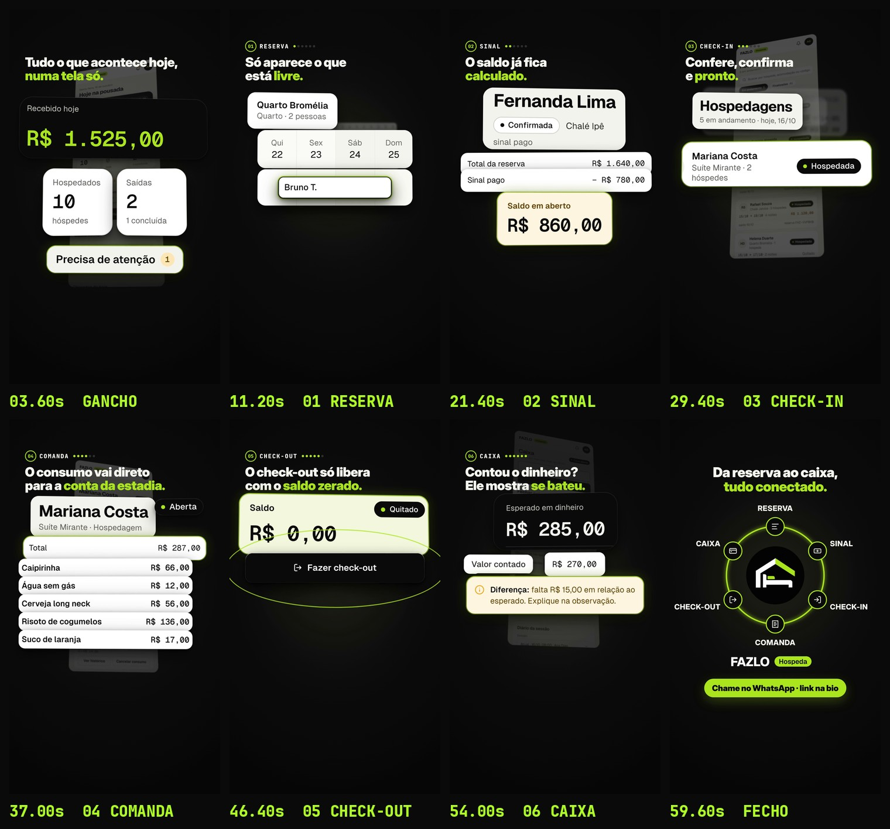

# FAZLO Hospeda — "Um dia inteiro da pousada" (reel de telas)

Reel 9:16 (1080×1920), **60,0 s**, 60 fps, H.264 + AAC, **sem voz**. Mostra um dia da Pousada Vale Sereno (sexta-feira, 16/10) no FAZLO Hospeda, do painel do dia ao caixa, com as **telas reais** do pacote `fazlo-hospeda-telas.zip`.

**Não publicar antes do OK.**

▶ **Vídeo:** [`output/um-dia-inteiro.mp4`](output/um-dia-inteiro.mp4)
- Storyboard (um quadro por etapa): [`output/storyboard.jpg`](output/storyboard.jpg)
- Capa da grade: [`output/capa-grade.jpg`](output/capa-grade.jpg) · conferência: [`output/grade/revisao/capa-no-feed.jpg`](output/grade/revisao/capa-no-feed.jpg)
- Legenda do post: [`legenda.txt`](legenda.txt)
- Revisão técnica: [`output/revisao/relatorio.txt`](output/revisao/relatorio.txt)



## Linguagem visual

- **Peças vivas, não prints.** Os HTML do pacote são abertos no Chromium com `deviceScaleFactor` 6–8 e recortados pelos ids do pacote (`#card-*`, `#status-chip-*`, `#valor-*`, `#btn-*`, `#modal-*`, `.item-comanda`…), ou pela caixa do texto dentro deles (`scripts/pecas.cjs` → `src/pecas/*.png` + `src/pecas.json`, com arquivo, posição e o menor corpo de texto de cada peça).
- **Sai da interface.** A tela de origem aparece ao fundo, inclinada e escura (a "fantasma", sem celular). A peça sai do lugar dela na tela e cresce no centro, sobre o preto da marca. Tem sombra suave e leve perspectiva (CSS 3D). O que é antigo recua e desfoca.
- **Toques:** onda limão no botão tocado, e o botão afunda.
- **Status:** o chip troca de cor na frente de quem assiste, numa íris. Os chips são Pré-reserva → Confirmada, Confirmada → Hospedada e Saldo em aberto → Quitado.
- **Valores:** contam dígito a dígito (odômetro). O valor é tirado do recorte (um "furo") e reescrito por cima, contando, na mesma fonte (Geist Mono) e no mesmo corpo, cor e posição.
- **O ciclo:** uma linha limão liga a última peça de cada etapa ao nó da etapa seguinte (01…06). No fecho, as 6 etapas voltam como anel em volta da logo.
- **Um destaque por vez:** contorno limão na peça em foco. Cada valor fica parado e legível ≥ 1,5 s.
- **Texto:** Inter Display 900, 66–70 px, palavra-chave em limão. Peças ampliadas até o menor texto delas ter ≥ 40 px no quadro.

## Roteiro (120 BPM)

| Tempo | Etapa | O que aparece (telas do pacote) |
|---|---|---|
| 0–4,5 s | **Gancho** | "Sexta-feira, 16/10. Pousada Vale Sereno." O painel do dia (`01-visao-geral`) se monta: Recebido hoje **R$ 1.525,00** (conta), **10** hospedados, **2** saídas, Precisa de atenção **1**. "Tudo o que acontece hoje, numa tela só." |
| 4,5–14 s | **1 Reserva** | O calendário de 14 dias (`02-calendario`, versão de computador, que mostra os 14 dias; o seletor de visão não aparece) se enche de barras. Nova reserva (`03`): 22/10 → 25/10, **Livres no período · 5 de 10**, o toque no **Quarto Bromélia** (R$ 320,00). A barra **Bruno T.** cai no Quarto Bromélia, de 22 a 25. Flash do aviso **Período ocupado** (estado 08). "Só aparece o que está livre." |
| 14–22,5 s | **2 Sinal** | Gustavo Ribeiro · **Pré-reserva** (`04` estado 01). Toque em **Registrar sinal**. Sinal **R$ 315,00** → "Depois: reserva confirmada · saldo **R$ 735,00**" (`05` sinal-antes). Toque em **Registrar sinal e confirmar**. O chip vira **Confirmada** e vai para a reserva da Fernanda Lima (`04` estado 02): total **R$ 1.640,00**, sinal **− R$ 780,00**, saldo **R$ 860,00**. "O saldo já fica calculado." |
| 22,5–30,5 s | **3 Check-in** | Conferência dos dados da janela **Fazer check-in** (`06`), toque no botão, **Confirmada → Hospedada**, recibo "Check-in feito" e, na lista **Hospedagens**, Mariana Costa **Hospedada**. "Confere, confirma e pronto." |
| 30,5–38 s | **4 Comanda** | Comanda da Mariana Costa (`08`): Caipirinha 66, Água sem gás 12, Cerveja long neck 56, Risoto de cogumelos 136, Suco de laranja 17. O total sobe até **R$ 287,00**. "O consumo vai direto para a conta da estadia." |
| 38–47,5 s | **5 Check-out** | A conta se monta (`07`): diárias **2.440** + consumos **287** − descontos **157** = **2.570**, pagos **2.158**, saldo **R$ 412,00**. **Fazer check-out** com o cadeado fechado e "Libera com saldo zero". PIX + **Confirmar R$ 412,00** (`05` pagamento antes). O saldo vai a **R$ 0,00 · Quitado** (`05` depois), o cadeado abre e o botão libera. "O check-out só libera com o saldo zerado." |
| 47,5–55 s | **6 Caixa** | Os pagamentos caem no caixa por forma (`10`): PIX 900, Dinheiro 125, Cartão de crédito 380, Cartão de débito 120 → **R$ 1.525,00**. Esperado em dinheiro **R$ 285,00** (gaveta). Valor contado **R$ 270,00** e "Diferença: falta **R$ 15,00**". "Contou o dinheiro? Ele mostra se bateu." |
| 55–60 s | **Fecho** | As 6 etapas voltam como anel em volta da logo, com a marca FAZLO Hospeda: "Da reserva ao caixa, tudo conectado." Pílula **Chame no WhatsApp · link na bio**. |

## O que ficou de fora, e por quê

- **Linha do diário com o sinal do Gustavo:** não aparece. Nenhuma peça do caixa usa o diário, por causa da divergência registrada no LEIA-ME.
- **Gustavo confirmado:** essa tela não existe no pacote. O chip vira "Confirmada" sozinho, na frente de quem assiste, e vai para o cabeçalho da **Fernanda Lima**, a reserva confirmada do pacote. O nome dela aparece junto dos valores dela.
- **Hospedada na lista:** a lista de ativas do pacote não tem a Fernanda (o check-in dela é no dia 17). Aparece a Mariana Costa, que é a hóspede das etapas seguintes.
- **Barra nova do calendário:** é a reserva do Bruno Teixeira do próprio pacote (Quarto Bromélia, 22/10 → 25/10, "Nasce como Confirmada"). É desenhada com a barra de reserva confirmada da própria tela ("Bruna C." clonada), com o rótulo no padrão do calendário ("Bruno T."). O período está livre no calendário.
- **Fechamento:** o pacote só tem o fechamento com "Falta R$ 15,00". É ele que aparece.
- **Sem Day Use, Booking ou Airbnb. Não fala em versões.**

## Som

Trilha e efeitos sintetizados em Python (`scripts/audio.py`), com os instrumentos da v2: 2-step a 120 BPM, piano elétrico FM, marimba e baixo, de Fá♯ menor que resolve em Lá maior no fecho. Esta trilha tem mais respiro que a da v2:
- chimbal em colcheias;
- um compasso mais vazio a cada quatro;
- uma quebra enquanto o cadeado está fechado, que volta com impacto quando ele abre.

Cada etapa abre com um "ding" um grau acima do anterior. Os efeitos vêm de `audio/eventos.json`, exportado da própria animação:
- toque;
- troca de status;
- contagem dos dígitos;
- barra caindo;
- aviso;
- cadeado fechando e abrindo;
- moedas e gaveta do caixa;
- anel;
- sineta e impacto na logo.

Master em **−14 LUFS**, pico ≤ −1,5 dBTP.

## Arquivos e como renderizar

```
reels/telas/
  _material/fazlo-hospeda-telas/   # pacote extraído (o .gitignore deixa no git só o que o vídeo usa)
  um-dia-inteiro/
    scripts/pecas.cjs       # recorta as peças dos HTML (Chromium, DPR alto) -> src/pecas/, src/pecas.json
    scripts/render.cjs      # video | stills | dados (caixas por quadro, destaques e eventos)
    scripts/audio.py        # trilha + efeitos -> audio/trilha.wav
    scripts/storyboard.py   # output/storyboard.jpg
    scripts/qa.py           # output/revisao/relatorio.txt
    src/index.html, src/anim.js   # palco (preview com play/scrub e página do render); REEL.renderAt(t) é determinístico
    src/fonts/              # Inter Display, Geist e Geist Mono (pacote npm "geist"), JetBrains Mono (OFL)
    src/assets/             # logo, ícones do anel e as telas de fundo (do pacote)
```

```bash
cd reels/telas/um-dia-inteiro
node scripts/pecas.cjs                       # 1) peças (só se o pacote mudar)
node scripts/render.cjs dados --fps 30       # 2) eventos do som + dados do QA
python3 scripts/audio.py                     # 3) trilha
node scripts/render.cjs video --workers 4    # 4) output/um-dia-inteiro.mp4
python3 scripts/storyboard.py                # 5) storyboard
cd ../../.. && node reels/tools/capa_grade.cjs reels/telas/um-dia-inteiro \
  && python3 reels/tools/revisao_capa.py reels/telas/um-dia-inteiro --saida reels/telas/um-dia-inteiro/output/grade --vizinhos v2
cd reels/telas/um-dia-inteiro && python3 scripts/qa.py
```

Preview: `npx serve reels/telas/um-dia-inteiro` e abrir `/src/index.html` (`?t=12.5` abre num instante).
