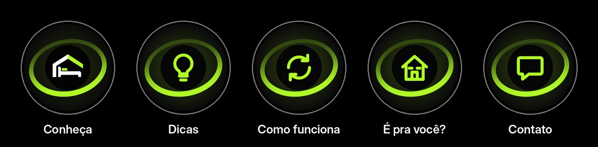
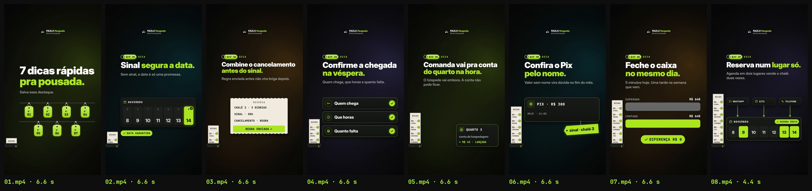

# FAZLO Hospeda — Stories para Destaque (modelo reutilizável)

Stories animados com **conteúdo próprio** para os Destaques do Instagram (não são reposts de Reels). Cada destaque é **um JSON** nesta pasta e sai inteiro por quatro comandos. A identidade é a da Série EXPLICA ([`../../reels/serie-explica/`](../../reels/serie-explica)): a notinha, o chaveiro de chalé "Nº", o fundo escuro com tom por Story, o limão `#AFFA27`, Inter Display + JetBrains Mono e a logo oficial (o arquivo, sem redesenho). Sem telas do sistema e sem figurinhas.

## Entregas

| | Arquivos |
|---|---|
| **Capas dos Destaques** (1080×1080; o Instagram recorta o círculo central) | [`output/capas/dicas.png`](output/capas/dicas.png) (lâmpada) · [`como-funciona.png`](output/capas/como-funciona.png) (setas em ciclo) · [`e-pra-voce.png`](output/capas/e-pra-voce.png) (chalé) · [`contato.png`](output/capas/contato.png) (balão de mensagem) |
| **Prévia das capas, como no perfil** (com o "Conheça") | [`output/capas/previa-perfil.jpg`](output/capas/previa-perfil.jpg) · em fundo claro: [`previa-perfil-claro.jpg`](output/capas/previa-perfil-claro.jpg) |
| **Destaque "Dicas"** (8 Stories, na ordem de postagem) | [`output/dicas/01.mp4`](output/dicas/01.mp4) … [`08.mp4`](output/dicas/08.mp4) |
| **Prévia** (1 quadro de cada Story) | [`output/dicas/previa.jpg`](output/dicas/previa.jpg) |
| **Revisão técnica** | [`output/dicas/revisao/relatorio-tecnico.txt`](output/dicas/revisao/relatorio-tecnico.txt) · [`faixas.jpg`](output/dicas/revisao/faixas.jpg) |




As capas seguem o desenho da capa do "Conheça" ([`../conheca/`](../conheca)): o mesmo halo limão, o mesmo anel em 3D (a metade de trás em oliva, a da frente em limão) e, no centro, um disco escuro do tamanho do círculo da logo, com o ícone em limão. Lado a lado, as cinco formam um conjunto.

## O formato (regra fixa)

- **Vídeo:** 1080×1920, 60 fps, MP4 H.264 (yuv420p), **6–8 s**, **sem áudio** (Destaque costuma ser visto sem som).
- **Faixas do Instagram:** nenhum texto em **y < 250** nem em **y > 1670**. A marca fica em y ≈ 312, a impressora da notinha em y ≈ 1572–1610.
- **Leitura:** todo texto entra até ~2,6 s e fica **parado ≥ 3 s** até o fim. Plaquinhas que balançam param antes de contar como paradas.
- **Cartões:** nenhum texto passa da borda do cartão que o contém (folga ≥ 12 px; a checagem da Série EXPLICA, medida na posição real na tela).
- **Notinha:** uma fita de papel na esquerda (x 20–140) que sai da impressora:
  - o 1º Story imprime o cabeçalho (`nota.topo`);
  - cada Story de dica imprime a sua linha ("01 · SINAL"), e a linha ganha o check limão quando o elemento termina; nos Stories seguintes, as linhas anteriores já vêm impressas, com check;
  - o Story com `"fecho": true` imprime o fim (`nota.fim`, "7 DE 7 ✓") junto com a passagem para a logo.
- **Chaveiro:** cada dica tem o chaveiro de chalé "Nº 01" ao lado do rótulo mono ("DICA"); ele balança ao entrar e para.
- **Fecho:** nos últimos 3 s do Story com `"fecho": true`, uma passagem limão leva à **logo oficial FAZLO Hospeda centralizada**, com "FAZLO Hospeda" e o @. A notinha fechada continua à esquerda. A dica fica ≥ 3 s parada antes disso, por isso esse Story tem 8 s.

## Montar o próximo destaque (só pelo JSON)

1. Copie `dicas.json` para `<id>.json` (ex.: `como-funciona.json`) e troque `id`, `nome`, `nota` e os `stories` (formato abaixo).
2. Rode:

```bash
cd stories/destaques
node scripts/render.cjs video --d como-funciona     # output/como-funciona/01.mp4 …
node scripts/render.cjs info  --d como-funciona     # caixas para a revisão
python3 scripts/qa.py como-funciona                 # revisao/relatorio-tecnico.txt (termina em "RESULTADO: aprovado")
python3 scripts/previa.py como-funciona             # previa.jpg
```

As capas vêm de [`capas.json`](capas.json) (`{id, nome, icone}`): `node scripts/render.cjs capas` e depois `python3 scripts/previa.py capas`. Os ícones de capa são `lampada`, `ciclo`, `chale` e `balao`; ícone novo é um traço em grade de 24 em `ICONES_CAPA`, no `src/anim.js`.

Para ver no navegador: sirva `stories/destaques` e abra `src/index.html?d=dicas&s=3` (botões 01…08).

### Formato do JSON

```json
{
  "id": "dicas", "nome": "Dicas", "marca": "@fazlohospeda",
  "nota": { "topo": "DICAS", "fim": "7 DE 7" },
  "stories": [
    { "tipo": "abertura", "tom": "limao", "duracao": 7, "titulo": ["7 dicas rápidas", "pra pousada."], "apoio": "Salva esse destaque.", "elemento": { "chaves": 7 } },
    { "tipo": "cadeado", "n": 1, "rotulo": "DICA", "nota": "SINAL", "tom": "petroleo", "titulo": ["Sinal *segura a data.*"], "apoio": "…", "elemento": { … } },
    { "tipo": "agenda", "n": 7, "fecho": true, "duracao": 8, … }
  ]
}
```

- **`titulo`:** 1 ou 2 linhas. A 2ª linha sai em limão; `*trecho*` fica limão em qualquer linha (usado nos títulos de uma linha só).
- **`apoio`:** a frase cinza embaixo do título.
- **`tom`:** `limao`, `ambar`, `petroleo` ou `roxo`.
- **`duracao`:** 6–8 s (padrão 7).
- **`n`:** o número da dica (chaveiro e linha da notinha). **`nota`:** a palavra da linha da notinha, curta (até ~8 letras).
- **`fecho: true`:** só no último Story.

### Tipos de Story (`tipo`) e o `elemento` de cada um

| `tipo` | Visual | `elemento` |
|---|---|---|
| `abertura` | Título grande e o quadro de chaves da recepção: uma plaquinha "Nº 01…" por dica, penduradas em duas fileiras | `chaves` |
| `cadeado` | A semana no calendário; a data recebe o cadeado, que cai e fecha no **canto** da célula (nunca sobre o número nem a letra do dia), e o chip limão | `mes`, `dias[7]`, `nomes[7]`, `alvo`, `chip` |
| `regra` | Uma notinha grande com as linhas da reserva; a última, numa tarja limão, "REGRA ENVIADA ✓" | `cabecalho`, `linhas[]`, `enviada` |
| `checks` | Três linhas que ganham check, uma de cada vez | `itens: [{t, icone}]` |
| `comanda` | A comanda do bar (papel) desliza e entra no card do quarto, que mostra o valor lançado | `titulo`, `itens: [[nome, valor]]`, `total: [rótulo, valor]`, `quarto`, `conta`, `lancado` |
| `etiqueta` | O card do Pix ("de quem?") ganha uma etiqueta limão pendurada, que balança e para | `t`, `sub`, `duvida`, `etiqueta` |
| `fechamento` | Duas barras, esperado e contado; o contado enche até o esperado e entra o chip "DIFERENÇA R$ 0" | `esperado: [rótulo, valor]`, `contado: [rótulo, valor]`, `diferenca` |
| `agenda` | Os canais mandam setas para uma agenda só, que ganha o chip "AGENDA ÚNICA" | `canais: [{t, icone}]`, `mes`, `dias[7]`, `ocupados[]`, `chip` |

**Tipo novo:** é um bloco `EL.<nome> = { setup(s), draw(ctx, s, t) }` no `src/anim.js`. O `setup` define os tempos em `s.T` e devolve a hora da última mudança de texto (incluindo o tempo de qualquer balanço parar). O `draw` usa as peças prontas: `panel`, `chip`, `badge`, `icon`, `enter`/`ent` e `CARTAO` (para registrar um cartão que não é `panel`, como um papel). Título, apoio, chaveiro, notinha, marca, fecho e caixas para a revisão vêm sozinhos.

## Revisão do destaque "Dicas" (`scripts/qa.py`)

Resultado: **aprovado**.

- **Formato:** 8 Stories 1080×1920, 60 fps, H.264, sem áudio; 7 × 7 s + 8 s.
- **Faixas do Instagram:** nenhum texto em y < 250 nem em y > 1670.
- **Leitura:** todo texto parado de 3,8 a 5,0 s até o fim. No Story 08, a dica fica parada 3,05 s; depois, a logo e "7 DE 7 ✓" ficam parados os últimos 3,05 s.
- **Cartões:** nenhum texto passa do cartão que o contém.
- **Cadeado:** fica no canto da célula, sem cobrir o "14" nem a letra do dia.
- **Notinha:** 7 linhas com check, em ordem.
- **Sem trechos pretos.**

## Estrutura

```
<id>.json             um destaque (o único arquivo que muda entre destaques)
capas.json            as capas dos destaques e a prévia do perfil
src/anim.js           motor (window.DESTAQUE): fundo, marca, chaveiro, notinha, tipos de Story, fecho com a logo, capas
src/index.html        página de render e de prévia (?d=<id>&s=<n>)
scripts/render.cjs    video | capas | info | stills (Chromium headless, quadro a quadro, sem áudio)
scripts/qa.py         revisão técnica
scripts/previa.py     prévia das capas em círculos e prévia de um destaque
```
